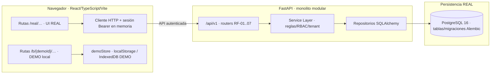
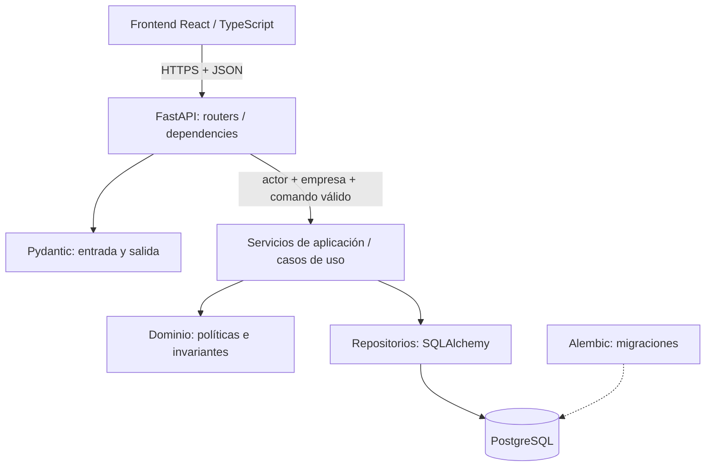
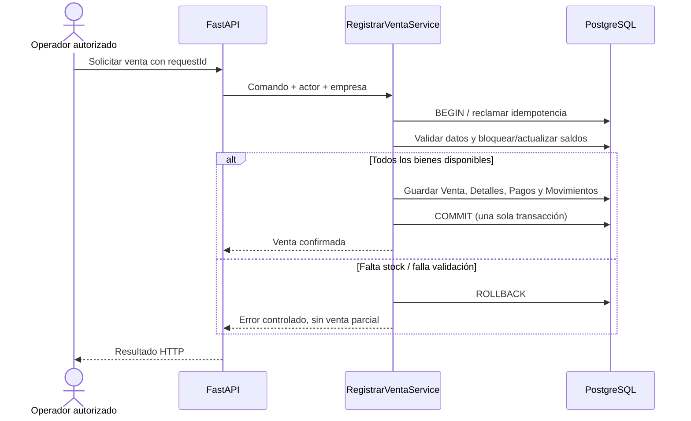

# 04 — System architecture and design patterns

**Current version:** 2.1 — E2-7 / T12-D1 (11/11/2026).  
**Project:** Orbit — generalist multi-company and multi-rub management platform (UNSAM Programming 2).  
**Unchangeable functional cut:** `main` `c6a77137cf82dcb9aad225645e84b1265b1da3ec` — PR #45 (T11).  
**Rama documental:** `docs/e2-7-t12-cierre-academico`, PR #46, sin merge a `main`.  
**Status:** **AS-IMPLEMENTED core RF-01..RF-07**. RF-08..RF-10 remain exclusively DEMO or deferred.  
**Sources of truth:** [Requirements 01](01_ANALISIS_DE_REQUERIMIENTOS.md), [use cases 02](02_CASOS_DE_USO.md), [dominio 03 v2.1](03_MODELO_DE_DOMINIO_Y_UML.md) y [API and traceability 05](05_MATRIZ_API_Y_TRAZABILIDAD.md).

> **Rule of mandatory precedence.** The sections **‘T12-D1 State in force’** describe the system actually implemented to cut T11; block **‘ARCHIVO HISTORICAL E2-3’**, at the end of this file, retains the entire design above (including TO-BE examples, old versions and figures). Your phrases in present ("not yet existing", "React follows DEMO", "no REAL sale") **no** The reading of a didactic example does not prove the existence of this class/pattern in the code.

## Current status T12-D1 — Executive view (first read this section)

**Architecture:** modular monolith FastAPI, Python, SQLAlchemy 2.x, Alembic and PostgreSQL 16; SPA React + TypeScript + Vite with two modes **DEMO local** y **REAL with API**. Docker Compose allows API execution and local base; GitHub Actions tests components with disposable QA environments. Each company is a logical tenant; WALOS is just an example client.

**Integrated functional sequence:** registration/login → company and membership → locations/allocations → catalog/providers → purchase → physical reception → stock → sale POS with declared payments. The REAL frontend uses the API as authority: does not reuse balances or identities of `demoStore`DEMO retains its own illustrative information. **No** there is bank accreditation, financial accounts or QR of productive collection in the REAL scope.

### A. Component diagram and confidence limit



**Interpretation:** HTTP arrow crosses the confidence limit; effective authorization always resides in FastAPI and not in the React menu. No arrow automatically copy data from `demoStore` a PostgreSQL.

### B. Implemented components and responsibilities

| Layer | Verifiable code and technology | Liability/invariant |
|---|---|---|
| REAL Presentation | `frontend/src/App.tsx`, screens `features/*`, `src/api/httpClient.ts` | Navigation, forms, error handling and session, without calculating stock authority or permissions |
| DEMO presentation | `frontend/src/data/demo/demoStore.ts` | Autonomous Prototype for UX; local values, no backend security |
| REST routing | `backend/app/api/v1/router.py`, routers en `app/modules/*` | **46 operations** en **13 routers**, segregated from `/health` y `/ready` |
| Implementation services | Services in `backend/app/modules/*`, p. ej. `sales/service.py` y `purchases/receipt_service.py` | Orchestration, transaction, role validation, tenant, headquarters, calculations and idempotency |
| Repositories | P. ej. `catalog/repository.py`, `purchases/repository.py` | Filtered queries by company; not done `commit()` on its own |
| Persistence | `backend/app/infrastructure/models/`, `infrastructure/db.py`, `alembic/versions` | FKs, UNIQUE, CHECK, indexes, company-based key and transactional operations |
| Infrastructure | `plataforma-pyme/compose.yaml`, `backend/Dockerfile`, `.github/workflows/plataforma-pyme-*.yml` | Development, IC and evidence on disposable bases; does not involve banking infrastructure or public production |

### C. Patterns that can defend themselves with evidence of code

| Pattern/focus | Actual status T11 | Evidence | Qué **no** affirm |
|---|---|---|---|
| **Repository** (architectural) | **IMPLEMENTED** | `CatalogRepository` y `PurchaseRepository` separate SQL access and rules; methods filter `business_id` | It is not automatically a GoF pattern nor does it guarantee complete abstraction in all modules |
| **Service Layer** | **IMPLEMENTED** | Sales, purchasing, reception and adjustment services apply authorization, calculations and mutations | No debe confundirse con simples handlers REST |
| **Transactional unit with SQLAlchemy** | **IMPLEMENTED AS PRACTICAL** | `infrastructure/db.py` generates isolated sessions; critical services confirm or reverse; atomic reception/sale | Do not attribute a formal class `UnitOfWork` if not available |
| **Observer** | **IMPLEMENTED DEMO** | `demoStore.subscribe`, `getSnapshot` y `useSyncExternalStore` | It does not amount to distributed events or multi-client persistence |
| **DTO/layer separation** | **IMPLEMENTED AS TECHNICAL** | FastAPI/Pydantic schemas and different ORM models | It is not automatically a specific GoF |
| **Adapter / Factory / Decorator** | **HISTORICAL OR FUTURE CONCEPTS**, not GoF certification | Examples in Appendix E2-3, not sufficient full implementation test T11 | Not declaring requirements fulfilled by showing pseudocode |
| **State / Command / Memento** | **NOT ACREDITED AS GOF** | SQL States, Input Commands and Snapshots are domain concepts | Do not convert equivalent names or behaviors into formal patterns |

**Pattern for academic defense:** prioritize **Repository** as observable separation and **Observer** as a GoF pattern effectively traceable in DEMO. Cit file, method and verifiable test; not promise dedicated Observer test if it was not executed. Release the official pattern slogan before asserting compliance with a particular rubric.

### D. Entities, authorizations and transactions

- **Multi-tenancy:** global identity `User`; `Membership` links user and company. Persistent roles `TITULAR_ADMINISTRATIVO`, `ADMINISTRADOR`, `ENCARGADO`, `TRABAJADOR`. Business verification and server membership, not by UUID known in browser.
- **Sedes:** `can_sell` y `can_store` Independents. Operational members need active assignment to operate at a headquarters; transfers require STORY in origin/destiny. Sales of goods require SELL and STORE capabilities; services do not debit inventory.
- **Purchases:** `Purchase` It retains snapshots, but to sign up a purchase does not move stock. `PurchaseReceipt` makes a full reception at most per purchase and only physical goods update balance.
- **Inventory:** `StockMovement` keeps signed facts; `StockBalance` contains materialized balance by tenant/headquarters/article with version and non-negativity. Transfer: debit/credit in a commit; setting: motif and version control; initial stock: only enabled administrators without torque history.
- **Sales:** `Sale`, `SaleLine`, `SalePayment`; amount in cents, amounts in thousandths, rounding HALF_UP per line. Declared payments must equal total; `MERCADO_PAGO_DECLARADO` **no** is equivalent to payment processed by Mercado Pago.
- **Idempotency:** `Idempotency-Key` for required commands and application footprint; new transactions persist `request_id` y `request_sha256` in relevant aggregates. **No generic table `SolicitudIdempotente`**. Retrying equally recovers the voucher; different body or actor involves conflict.
- **Concurrence:** check authorizations and stock within the transaction; a timeout does not justify generating another sale automatically. Reading balances from a company does not grant write permission at all its headquarters.
- **Browser security:** Bearer REAL in memory; F5 requires re-entry. Some pending business intentions are saved in IndexedDB **no encryption**This is product debt; not storing payment secrets there.

### E. Reproducible routes, demonstration and testing

| Mode | Typical access | Data source | Warning |
|---|---|---|---|
| REAL | `/real/registro`, `/real/login`, `/real/empresas`, `/real/empresas/{businessId}/...` | FastAPI/PostgreSQL | Do not treat as productive public deployment or use real customer data/sales |
| DEMO | `/inicio` y `/b/{demoId}/...` | Local Prototyping Storage | No bank authentication or reconciliation; non-scannable illustrative QR |

**Safe and non-destructive testing** (from the root of the repository, PowerShell, if dependencies are already installed):

```powershell
cd plataforma-pyme/frontend
npm.cmd run build
npm.cmd run lint
npm.cmd run test:api
npm.cmd run test:auth
npm.cmd run test:businesses
npm.cmd run test:operations-real
# Volver a la raíz antes de abrir otros proyectos:
cd ../..
```

**PostgreSQL tests:** only with base **disposable and expressly identified** according to [backend guide](../backend/README.md). Do not execute migrations, writing suites or cleaning on a personal basis without first confirming the connection destination. For T11, the [technical report](../docs/E2-7_T11_E_AUDITORIA_FINAL_PREMERGE.md) reports **892 Pytest + 38 Playwright REAL + 6 DEMO**, en el commit funcional `6aecd80e...`; **are historical evidences**Not a new IC executed when publishing T12.

**IC control of the documentary branch:** current workflows are filtered by changes in frontend/backend/compose; a PR that only changes Markdown, PlantUML or SVG may have **zero executions**. The closure of T12 requires static validation recorded in its minutes; not declaring a non-existent check green. Creating a new YAML workflow would exceed the documentary scope of this PR and is deferred.

### F. Valuable scope, limits and continuation

| Scope | State in court T11 | Reading for Defense |
|---|---|---|
| RF-01..RF-07 / CU-01..CU-12 | **REAL in FastAPI/PostgreSQL, with React screens and T11 evidence** | Built academic core, subject to complete criteria of delivery |
| RF-08 expenses and cash | **DEMO / DIFFERED** | No real backend for cashier or day reconciliation |
| RF-09 financial accounts | **DEMO / DIFFERED** | No real bank or authenticated financial balances |
| RF-10 Market Payment QR | **DEMO / DIFFERED** | No OAuth per company, no collection webhooks, no external accreditation |
| Partial reception, reservations, recipes/production, additional TP3 | **NOT CERTIFIED AS REAL** | Evaluate your correspondence with the original slogan without opening fictitious commitments |

**Product extension post-T12 (outside commitments RF-01..RF-07 of this closure):** (1) approximating REAL to visual experience and DEMO navigation; (2) generating ERD from PostgreSQL (DBeaver or equivalent, does not require migration to Supabase); (3) demo web/mobile drop down and accessibility tests; (4) payments QR Market Payment for each company with OAuth, verified webhooks, idempotency and reconciliation; (5) expenses/box/accounts, reserves and production by controlled scope phases. **Do not interpret this backlog as features already delivered.**

**Criteria for TP and TP3:** this architecture does not itself certify the official requirements of a unverified slogan entirely. Any requirement inherited from TP3 must be linked to RF/CU and actual evidence, or marked **not yet checked against consignment**. No requirement is automatically taken for granted.

### G. Related documentation and defence

- [Document 01](01_ANALISIS_DE_REQUERIMIENTOS.md) RF, REAL scope and DEMO.
- [Document 02](02_CASOS_DE_USO.md) — 12 specifications, 13 UML ovals per division of CU-12.
- [Document 03](03_MODELO_DE_DOMINIO_Y_UML.md) — classes, FKs, entities, leader, invariants and evolution.
- [Diagram 03A](diagramas/03A_IDENTIDAD_EMPRESAS_CATALOGO_REDISENADO.svg) — identity, companies and catalogue.
- [Diagram 03B](diagramas/03B_COMERCIO_INVENTARIO_REDISENADO.svg) — modelo comercial, ledger y stock.
- [Explanatory diagram 03B](diagramas/03B_FLUJO_COMERCIAL_EXPLICATIVO.svg) — business reading for exhibition.
- [Diagram 03C](diagramas/03C_CASOS_DE_USO_REDISENADO.svg) — functional actors, permits and UC.
- [Document 05](05_MATRIZ_API_Y_TRAZABILIDAD.md) — 46 endpoints y correspondencia UI/test.
- [Current ADR Index T12](../docs/ADR/README.md) — status applied/partial/differed from ADR-001.008, with preserved historical sources.
- [README de entrega](README.md) y [diagram guide](diagramas/README.md).
- [Act T12-B](../docs/E2-7_T12_B_CONCILIACION_RF_CU_API_UI_TEST.md) y [Plan T12-A](../docs/E2-7_T12_A_PLAN_Y_MATRIZ_DESFASES.md).

---

## ARCHIVO HISTORICAL E2-3 — Original preserved design (08/11/2026)

> **Permanent warning:** all the following text, including titles, sections, Factory/Decorator/Adapter proposals and implementation states declared in present, describes the **Cut E2-3**, NOT the code implemented from T11. The decisions conceived here should not be reinterpreted as verified patterns. This material is preserved for evolution audit.

### Original historical cover — 04 System architecture and design patterns

**Project:** Orbit — Generalistic multi-company and multi-rub management platform  
**Materia:** Programming 2  
**Version:** 1.9 — E2-3 E, real catalogue and 580 Windows tests
**Status:** **BASE PROPOSAL + ANNEX OF REALLY IMPLEMENTED BACKEND COMPONENTS** — academic approval of the pending equipment  
**Date:** 8 November 2026  
**Contrast base:** `main` repository `JoaquinOjedaDev/Orbit`, commit `764ba20674f14621e381a4e9753017070943f2e3` (frontend and documents 01–03). **historical baseline** prior to E2; the current status is recorded in annex E2 of this document.  
**Related documents:** [01 — Requirements](01_ANALISIS_DE_REQUERIMIENTOS.md) · [02 — Cases of use](02_CASOS_DE_USO.md) · [03 — Modelo de dominio y UML](03_MODELO_DE_DOMINIO_Y_UML.md).

> **Scope and mandatory reading.** **AS-IS** indicates verifiable functionalities on the DEMO frontend; **TO-BE** identifies decisions and architecture to be implemented in FastAPI; **DIFFERENT** The schemas, folders, interfaces, Python fragments and endpoints proposed in this document **are not existing backend code or run backend tests**. This version is subject to revision before uploading it to GitHub.

> **Closing E2-1 / C.5 — 08/11/2026:** C.1 (98), C.2 (125), C.3 (147), C.4a (171) y C.4b **195/195 approved local tests** (`195 passed in 23.86s`). Alembic `e213c4_acceptance (head)`, without new operations; API and PostgreSQL Docker `healthy`, `/ready` = `ready`/`ok`. CI **3/3** del commit funcional `8cd1674`C.5 is exclusively documentary, does not involve new tests, migrations or endpoints. React continues DEMO; RF-03–RF-07 are still pending.

## Summary of decisions of this review

**Project design and scope are maintained.** The proposal is a **monolito modular FastAPI + PostgreSQL**Not microservices. **Repository** continues as the main pattern for backend; **Observer** is present on the frontend as a subscription mechanism; **Factory y Decorator** are documented with examples and possible application tests. Adapter accompanies future migration; do not confuse proposals with implementations.

This revision requires nine important decisions:

1. **SQLAlchemy 2.x synchronous ORM → endpoints FastAPI `def`**, without running blocking calls directly into an endpoint `async def`; short sessions and never shared between concurrent applications.
2. **A transaction by critical command**Repositories prepare queries and writings, but **no ejecutan `commit()`**. The work/service unit controls a single commit or rollback.
3. **Non-existent balance = zero for outputs; first input = UPSERT atomic**. No zero balances will be created for all combinations of items and locations.
4. **PostgreSQL 16 proposed for Docker Development**, that supports `UNIQUE NULLS NOT DISTINCT`; composite FKs need unique keys compatible with parent tables.
5. **Permitted zero priced bonus lines, positive sale final total** during the MVP already agreed. The discount of the contract will be **a fixed amount of whole cents**; percentage, if it exists as visual aid, is explicitly converted before sending it.
6. **DTO output decoupled from ORM**: the backend does not return SQLAlchemy objects associated with sessions that have already been closed. The maps will be explicit but simple; no additional framework is needed.
7. **Change of company protected against obsolete responses**: queries with business environment, cancellation when possible and discard by context/version even if a late response arrives. A network failure should not activate silent DEMO writing.
8. **Unequivocal session ownership in each command**: the service opens its transaction through a session factory; business authorization and critical deeds use the same context, without reusing an ORM session between dependencies, threads or requests.
9. **Minimum quality contracts before programming**: structured error, exact monetary scheme, versioned API, verifiable migrations, unitary and integration tests PostgreSQL clearly separated; interfaces/patterns will be implemented when they provide value.

**Backend tests had not yet been performed in preparation for base v0.4**; Annex E2 at the end records subsequent local implementation and results, without attributing them to that commit.

> **State in force E2-2 (08/11/2026):** RF-03/CU-04 and E2-2 A/A.1/B/C/D implemented, with locations, partner assignments, tenant authorization and reusable operational policy. **371/371 tests on Windows (47.57s)**; `e22d_assignments (head)`; Alembic without pending operations; Docker FastAPI/PostgreSQL `healthy` y `/ready` = `ready/ok`. IC code E2-2 D: 3/3 and 371 tests in Python 3.12 and 3.14. **No** React–API integration and commercial purchases/stock/sales transactions that consume the policy are still in place; they correspond to later blocks. The previous cut-off paragraphs that mention validations or "pending" functions are retained as **history**, not as current state. The integral TP is not declared finished.


## 1. Purpose and design criteria

This document explains **how it will be built** The first API of Orbit and how it will live with the frontend that already works. It complements Document 01 (what the system needs), Document 02 (which objectives its actors fulfill) and Document 03 (which entities and rules make up the domain). It does not replace the future Document 05, which will fix verifiable HTTP contracts, nor Document 06, which will gather evidence and evidence of deployment.

The platform is **multi-enterprise and multi-rub**. WALOS is only a fictitious or example company; it does not condition the entities or the permissions of the product. A person may belong to several companies, with different responsibilities, and the operations of each company must remain isolated on the server.

**Architectural objectives:**

1. Comply with the academic slogan by means of a **API RESTful en FastAPI** with secure authentication, **SQLAlchemy**, persistent SQL database, **Docker**at least **ten unit API tests**, **GitHub Actions**display and a design pattern **actually implemented and justified**.
2. Protect domain invariants: exact money, non-receiving purchase, no negative stock, full receipt by purchase, accurate declared payments and retryings that do not duplicate transactions.
3. Replace DEMO storage **progressively**without losing the possibility of continuing to show the frontend above as the API grows.
4. Prioritize **clarity, traceability and testing** above a premature distributed architecture. Microservices, queues, Redis or a specific cloud are not required to validate the MVP.
5. Avoid a second real origin: **when a module uses the API, business data from that module must come from the server**; will not be automatically mixed with local browser logs.

### 1.1 Status of documents

- **Current status C.5:** 01 v0.8, 02 v0.9, 03 v0.9, 04 v1.0 and 05 v0.6. Initial decisions are retained as **architecture history**; should not be interpreted as a current photograph of `main`03B remains conceptual for modules not yet implemented.

## 2. Existing architecture — AS-IS: frontend DEMO

### 2.1 Technologies and archives found

| Component | Actual status in `main` | Evidence in the repository |
|---|---|---|
| Interface | **React + TypeScript + Vite**, SPA | `plataforma-pyme/frontend/package.json` y `src/App.tsx` |
| Navigation | History API con `history.pushState`, `popstate`, routes in `App.tsx` and registration `navigation.ts` | `src/App.tsx`, `src/app/navigation.ts` |
| DEMO corporate state | Shared status and React subscription by **`useSyncExternalStore`** | `src/data/demo/demoStore.ts` y `useDemoSnapshot()` |
| Commercial persistence | `localStorage`, versioned key `asistente-pyme.e1a2.demo.v1`; data per company in snapshot | `src/data/demo/demoStore.ts` |
| DEMO images | `IndexedDB`, optimized and isolated blobs by enterprise key/fiche | `src/data/demo/imageStorage.ts`, `imagePolicy.ts` |
| Functional rules | Features/policies TypeScript for catalog, purchases, inventory, sales, equipment, box, accounts and fictitious QR | `src/data/demo/*Policy.ts` |
| Frontend quality | Build TypeScript/Vite, Lint Oxlint, Node and E2E tests with Playwright Chromium desktop/mobile | `frontend/package.json`, `frontend/tests/`, `frontend/e2e/`, `.github/workflows/plataforma-pyme-frontend.yml` |
| Backend/API | **FastAPI/SQLalchemy/PostgreSQL for actual RF-01/RF-02** | `backend/app/`, `backend/alembic/`, `backend/tests/`; frontend React remains DEMO disconnected |

**Correction in front of historical documents:** There's no evidence of **React Router**, **Zustand** ni de un `AppGateway`/`ApiGateway` implemented in this state. **If exported object exists `demoGateway`** dentro de `demoStore.ts`; there is still no common interface of DEMO/API adapters. These names are listed in E0/ADR proposals, **no** describe the current runtime. **frontend DEMO** There is no authentication or server authorization, actual payments or multi-user synchronization; **in the backend E2 there is** authentication, business permissions, SQLAlchemy and migrations.

### 2.2 Simplified actual structure

```text
plataforma-pyme/
├── frontend/
│   ├── src/
│   │   ├── App.tsx                 # composición y navegación actual
│   │   ├── app/                    # menú, enlaces, shell y tipos UI
│   │   ├── features/               # pantallas por área de negocio
│   │   └── data/demo/
│   │       ├── demoStore.ts        # estado compartido y comandos DEMO
│   │       ├── *Policy.ts          # validaciones/reglas locales
│   │       └── imageStorage.ts     # fotos en IndexedDB
│   ├── tests/                      # tests de políticas
│   └── e2e/                        # Playwright separado
├── docs/                           # historial técnico E0/E1 y ADR
└── entrega-programacion-2/         # documentación académica
```

Today's cash flow is **React → functions screen `demoStore`/local policies → `localStorage` o `IndexedDB` → React update**. TypeScript validations are applied to protect DEMO status, but **a browser does not offer reliable insulation or backend permissions**Local data are not user-to-user transactions.

### 2.3 What already works in front of the API cut

The frontend incorporates profiles and fictitious companies, locations, equipment and simulated invitations, catalog, suppliers, purchases, full reception, movements/stock, sales with declared payments as well as expenses, cashier, financial accounts and QR illustrative. **is not obliged to immediately replicate all those screens**.

Images are saved locally; QR is **DEMO not scanable and does not credit money**. Current E2Es are not evidence of authentication or postgreSQL continuance, and frontend tests **do not replace** the ten unit tests required from the backend.

## 3. Objective architecture — TO-BE

### 3.1 Style and scope decisions

A proposal is made for **modular monolith**: a FastAPI application organized by domain areas, with a single PostgreSQL base and Alembic migrations. HTTP requests enter routers; usage cases are executed through services; repositories encapsulate SQLAlchemy queries; entities and policies define trade rules. **database transaction is the limit of consistency** for operations that modify several tables.

**Planned technologies:** Python (compatible version to fix in E2), FastAPI, Pydatic, SQLAlchemy 2.x, Alembic, **PostgreSQL 16** as a Compose environment target for MVP, pytest, HTTPX, Docker/Docker Compose and GitHub Actions. PostgreSQL 16 is proposed to maintain compatibility with documented restrictions but **the container and its migrations have not yet been tested**. The exact versions of libraries and the final image (preferably with smaller version/digest fixed for reproducibility) will be confirmed in the E2 manifests.

**Execution model chosen for the first API:** SQLAlchemy **synchronous** con `Session` and synchronous driver. **the endpoints that call the ORM blocker will be `def` y no `async def`**: FastAPI executes the synchronous path functions in a *threadpool*, avoiding directly blocking the event loop. Also synchronous dependencies can be run in that string group. **no** returns asynchronous to the base: each request continues to occupy the *pool* of connections and *threadpool* capacity; reasonable limits must be adjusted and slow queries controlled. **No** pass one `Session` from one request to another, to work in the background or between concurrent works; nor do they share it between `asyncio.gather`.

Un endpoint `async def` remains valid for genuinely asynchronous work without blocking synchronous calls; **do not mix a direct SQLAlchemy call into it**, nor hide it within a utility `def` invoked from `async def`. Para un endpoint SQL se elige **path `def` + Synchronous service + synchronous repository**. The factory `sessionmaker` can be shared; **the instance `Session` no**. Each command creates and uses its own session in a non-concurrent way. `def` run in the *threadpool* does not guarantee that all dependencies of a request are executed on the same thread; therefore it is preferred not to transport open ORM sessions between layers/dependencies with ambiguous life cycle. If later on you need async from end to end, consciously migrate to `AsyncSession` and compatible driver, avoiding creating two styles of data access without justification.

**Load control:** running paths in *threadpool* avoids blocking the event loop, but **does not increase magically** The number of PostgreSQL connections and the number of threads that can be filled in to slow queries must not be saturated. E2 should use waiting times, indexed queries, pool limits and tests for two real requests. [FastAPI — attendance and async/await](https://fastapi.tiangolo.com/async/).

### 3.2 Component View



The drawing is a **architecture view**, not an UML class diagram or an existing implementation.

### 3.3 Responsibilities and prohibitions

| Layer | Liability | You mustn't do |
|---|---|---|
| **React presentation** | Forms, navigation, feedback, transition status of UI and HTTP calls | Authorize companies, decide definitive stock, write directly to PostgreSQL |
| **Routers FastAPI** | Expose routes, resolve dependencies, translate requests/answers, manage HTTP codes | Contain all sales/reception logic or make several `commit()` |
| **Pydantic / DTO** | Validate form, types, limits and serialization of the external contract; define independent DTOs from the ORM session | Suppose an ID belongs to the company without consulting server |
| **Data mapping** | Explicitly translate between input DTO, commands, entities/ORM and response DTO when models differ | Deliver live ORM instances to HTTP response or add generic mirror mapping |
| **Implementation services** | Orchestrate CU, permissions, rules, power, transactions and results | Depending on React screens; distributing an atomic operation into different commissions |
| **Domain / policies** | Calculate verifiable money/quantities, states and trade decisions | Connect rules to HTTP or an ORM when they can be expressed as pure functions |
| **Repositories** | Search for and persist entities/collections with SQLAlchemy; company-specific queries; atomic SQL operations | Decide business roles or return `HTTPException` |
| **Work unit/session** | Delimit commit/rollback and session life cycle | Partially confirm a commercial transaction that should be indivisible |
| **PostgreSQL** | Persistence, uniqueness, referential integrity, restrictions, blocking and transactions | Trust only frontend validations to avoid corrupt records |

**Dependency rule:** services use repository contracts when abstraction brings value; specific repositories use SQLAlchemy. Business errors are translated to HTTP at the border, without filtering SQL exceptions or internal traces. **No repository calls `session.commit()`**; transactions are confirmed from the use case or work unit. By logging out, the response must already be represented by independent ORM data.

**State ownership rule:** el `Engine` and the session factory is initialized in infrastructure and can be reused; **each request/command gets its own session, uses it sequentially and closes it in the same range**. FastAPI dependencies deliver authenticated context as immutable data, not a mutable session that must survive at various injection levels. The business service rereads its membership and permissions in your transaction before writing.

## 4. Proposed structure of folders and modules

The following structure was a **historical proposal of E2 start**. Currently `backend/` exists with authentication and business modules, SQLAlchemy, migrations and tests. The concept tree is retained as a design reference, not as literal inventory of the repository.

```text
plataforma-pyme/
├── frontend/                         # se conserva tal como funciona
├── backend/                          # ya existe en E2; el resto es esquema ilustrativo
│   ├── app/
│   │   ├── main.py                   # instancia FastAPI; routers; errores
│   │   ├── api/
│   │   │   ├── dependencies.py       # identidad, pertenencia, sesión
│   │   │   └── v1/
│   │   │       ├── auth.py
│   │   │       ├── businesses.py
│   │   │       ├── locations.py
│   │   │       ├── catalog.py
│   │   │       ├── suppliers.py
│   │   │       ├── purchases.py
│   │   │       ├── inventory.py
│   │   │       └── sales.py
│   │   ├── core/
│   │   │   ├── settings.py           # variables de entorno
│   │   │   ├── security.py           # credenciales, tokens o sesiones
│   │   │   └── errors.py             # errores de dominio -> HTTP
│   │   ├── domain/
│   │   │   ├── policies/             # dinero, unidades, estados
│   │   │   └── exceptions.py
│   │   ├── application/
│   │   │   ├── services/             # casos de uso
│   │   │   ├── ports/                # protocolos de repositorios
│   │   │   └── unit_of_work.py      # frontera de transacción
│   │   ├── infrastructure/
│   │   │   ├── db.py                 # engine y sessionmaker
│   │   │   ├── models/              # ORM (tablas SQL)
│   │   │   └── repositories/        # adaptadores SQLAlchemy
│   │   └── schemas/                  # DTO Pydantic; mapeo explícito junto al servicio cuando convenga
│   ├── alembic/                      # migraciones versionadas
│   ├── tests/
│   │   ├── unit/
│   │   └── integration/
│   ├── pyproject.toml                # dependencias/pytest (a definir)
│   ├── alembic.ini
│   ├── Dockerfile
│   ├── .env.example
│   └── README.md
├── compose.yaml                      # propuesta; ubicación final a aprobar
├── docs/                              # histórico de desarrollo
└── entrega-programacion-2/          # documentación académica
```

**Modularity criterion:** do not add subfolders or artificial interfaces where there is no need; for example, a repository per entity only if it encapsulates a reusable operation. The pattern is shown with at least one real circuit such as sale or reception. Avoid hundreds of DTOs and abstractions before the first endpoint.

## 5. Design patterns: choice, application and evaluation

### 5.1 Main pattern: Repository (repository)

**Problem:** purchasing, inventory and sales services require consulting and modifying persistent data, but should not depend on specific SQL queries or SQLAlchemy details. If each endpoint mixes HTTP, permissions, rules and SQL statements, the tests are coupled to the database and increases the probability of partial operations.

**Proposed solution:** define a small interface that expresses domain operations (see pending purchase, obtain stock, discounted conditionality, save sale) and build an implementation using SQLAlchemy. Services use this contract and do not know how queries are issued.

**Example illustrative of Python contract — NOT implemented:**

```python
from typing import Protocol
from uuid import UUID

class StockRepository(Protocol):
    def descontar_si_alcanza(
        self, business_id: UUID, ubicacion_id: UUID,
        articulo_id: UUID, cantidad_milli: int,
    ) -> bool: ...
```

A real implementation of `SqlAlchemyStockRepository` execute a `UPDATE` conditional or block the balance, verify affected rows and participate in **the same meeting/transaction** that keeps the sale and history. `FakeStockRepository` in tests will allow simulate results `True/False` no need for PostgreSQL to test the business rule. **Fake does not replace integration tests with PostgreSQL** for attendance.

**Verifiable benefits:** Separate responsibilities, unitary tests of services without DB, exchange of technology of persistence without changing the case of use, and centralization of business consultations. **Costo:** more files and contracts; that is why only the abstraction actually used will be implemented.

### 5.2 Supplementary pattern: Service Layer + Unit of Work

El **application service** executes a full-use case, for example `RegistrarVentaService`. Receives an authorized identity/company and a validated command; applies domain rules, controls idempotence and coordinates repositories. **Unit of Work** or transactional context ensures that **all deeds of the case are confirmed together or none is confirmed**.

**Mandatory rules for proposed implementation:**

- Each case of use that modifies multiple records has **a single owner of the commission**. The service or the UoW confirms; repositories only query, add, do `flush()` when necessary and execute atomic SQL **within the session received**.
- `flush()` **no equivale a commit**: serves to issue SQL/get identifiers and keep everything revertible if an error occurs.
- No ejecutar `commit()` in authentication dependencies, routers or repositories accidentally; do not close the session before constructing the response.
- La **membership consultation** the tenant for initial authorization may be in a reusable dependency, but each command must revalidate it **mutable and responsive to competition** under the appropriate transaction (e.g. pending purchase, active item, location and stock).
- Capture `IntegrityError` and other infrastructure exceptions only where an expected conflict can be distinguished; otherwise, allow rollback and translate to a controlled error at the HTTP border.

**Minimum recommended, illustrative form — does not yet exist in the repository:** The Annotation `sessionmaker[Session]` indicates a SQLAlchemy session factory that offers the transactional context `.begin()`; **no** is any function `Callable` returning a `Session`.

```python
from sqlalchemy.orm import Session, sessionmaker

# session_factory: sessionmaker configurado por infrastructure/db.py
# Command, SaleResult y las clases de repositorio son contratos por construir.

def registrar_venta(command: "SaleCommand", session_factory: sessionmaker[Session]) -> "SaleResult":
    with session_factory.begin() as session:  # BEGIN / COMMIT / ROLLBACK / CLOSE
        sales_repo = SqlAlchemySalesRepository(session)
        stock_repo = SqlAlchemyStockRepository(session)
        # Validar contexto empresarial y clave idempotente en esta transacción.
        # Revalidar artículos/ubicación y controlar saldos atómicamente.
        # Persistir venta, renglones, pagos, movimientos e idempotencia.
        result = execute_sale_command(command, sales_repo, stock_repo, session)
        dto = SaleResult.from_result(result)  # datos puros, sin ORM vivo
    return dto
```

This fragment is **pseudocode Structural Python**, not a complete implementation: classes, mapping method and `execute_sale_command` does not exist. For E2 it is valid to use directly `with session_factory.begin() as session` **sin** build a proper UnitOfWork class. Only one object will be entered `UnitOfWork` that encapsulates repositories when it provides real improvement of readability or testability. **transactional limit** matters more than the number of classes.

**Recommended unit injection for writing operations:** the route `def` receives an unchangeable main authenticated and the session/service factory, **no** an SQLAlchemy instance `Session` shared. Within the service opens `with session_factory.begin() as session`; there the corresponding membership of the company is reread, the specific permission is verified and the complete change executed. This prevents the decoupling between a first reading of permits in another session and the commercial commit. At the end of the business, the transaction verifies global identity and creates Company + Initial Membership. **An endpoint should not open a second session for a part of the same operation or confirm outside the defined limit.**

**Readings:** a query service can use `with session_factory() as session` without commit; you must close the session before responding with your DTO. For projects that adopt `get_db()` con `yield`, the team can do it if you set **a single owner** and avoid concurrent access to that session. Do not mix without analysis `Session.begin()` nested, commit at the end of dependencies and sessions in different threads.

**Semantics transactional errors:** If an operation fails, an exception must be propagated until it leaves the transaction block, which rolls back. A negative validation should not result in a 'success' result that causes partial writing to commit. If an idempotent error response persists, define whether it corresponds to a separate transaction **no commercial effect**and distinguish re-tryable conflicts from definitive failures.

**Future evidence:** a sales or reception circuit with service code and repositories, one transaction only, test with Fake repository, induced failure test that produces real rollback in PostgreSQL and no commit within the repositories. Reference: [SQLAlchemy 2.x — transactional framing](https://docs.sqlalchemy.org/en/20/orm/session_basics.html#framing-out-a-begin-commit-rollback-block).

### 5.2.1 Model mapping and DTO — separation practice, no additional mandatory pattern

- **Router/DTO de entrada:** validates HTTP contract format (UUID, integers, strings, limits) and generates an application command.
- **Service/domain:** decides rules, save snapshots and produces an independent application result of open sessions.
- **Repository/ORM:** obtains and persists rows with SQLAlchemy; the ORM model is not an object that must be serialized blindly as a public result.
- **Response status:** sets out expressly defined fields and excludes `password_hash`, tokens, secrets and internal data; built **before the session closes** or from already loaded values.
- **Stable departure contract:** The API returns explicitly mapped Pydatic structures or dataclasses (UUID, enum, cents, UTC dates); lazy load ORM relationships do not participate in HTTP serialization.

**Conceptual example of mapping:** `VentaORM(id, total_centavos, ...) → SaleResult(id, total_cents, ...) → SaleResponse`, without filtering a whole entity. The method can be a simple function tested; **no** it is mandatory to introduce a Mapper framework or maintain three redundant rates if the DTO of application already complies with the contract.

No add module required `Mapper` For each entity. Small explicit conversions can reside near the schemas or services and be covered with tests. It will avoid exposing lazy load ORM relationships outside a closed transaction or causing hidden SQL queries during serialization.

### 5.3 Recommended integration pattern: Adapter

Today the IU directly calls synchronous functions of `demoStore`. To integrate progressively with an asynchronous API it is proposed to build ports by functionality (for example `CatalogGateway`, `SalesGateway`) and two adapters:

```text
Página de catálogo
    -> interfaz de operaciones del catálogo
        -> adaptador DEMO: demoStore local (actual, envuelto cuando se migre)
        -> adaptador API: cliente HTTP /v1 (a desarrollar)
```

**The interchangeable adapters are TO-BE:** although there is already an object `demoGateway`, there is no common operating interface for DemoGateway/ApiGateway or a production API client yet. It should not be stated that `AppGateway`, `DemoGateway` o `ApiGateway` already exist. The Adapter pattern allows to maintain a stable interface while changing the fonts, but requires introducing syncrony and loading/mistake states; **It won't be enough to replace an import**.

This pattern is a clear alternative to **GoF pattern (Adapter)** if the chair requires one of that family; Repository is the main pattern of separation of persistence. Both must be demonstrated by **real classes or functions and tests**, avoiding declaring patterns just because there are folders called `services` o `repositories`.

### 5.4 Factory — consistent creation of movements (proposed for backend)

**What the book explains:** Factory encapsulates the construction of objects to decouple to the client code of creation details. Chapter 4 of *Head First Design Patterns* distinguishes simple factory, Factory Method and Abstract Factory. **A Simple Factory does not automatically match the GoF Factory Method pattern.**

**Problem in Orbit:** when confirming a receipt, sale, transfer or adjustment must create movements with company, article, location, signed quantity, origin and audit. If each service assembles all those fields manually, it can generate a negative input, omit a reference or produce only one of the two movements of a shipment.

**Proposed implementation:** a drafts of Inventory Movement concentrates the required types, signs and attributes. The service controls permits, purchase status, stock availability and idempotence; the factory **no** query SQL, do not update balances, do not publish events and do not commit.

~~~python
# EJEMPLO DIDÁCTICO TO-BE, no presente en el código.
from dataclasses import dataclass
from uuid import UUID

@dataclass(frozen=True)
class MovimientoDraft:
    empresa_id: UUID
    articulo_id: UUID
    ubicacion_id: UUID
    delta_milli: int
    origen: str
    origen_id: UUID

class MovimientoFactory:
    @staticmethod
    def venta(empresa: UUID, articulo: UUID, ubicacion: UUID,
              cantidad: int, venta_id: UUID) -> MovimientoDraft:
        if cantidad <= 0:
            raise ValueError("Cantidad inválida")
        return MovimientoDraft(empresa, articulo, ubicacion,
                               -cantidad, "VENTA", venta_id)

    @staticmethod
    def recepcion(empresa: UUID, articulo: UUID, ubicacion: UUID,
                  cantidad: int, recepcion_id: UUID) -> MovimientoDraft:
        if cantidad <= 0:
            raise ValueError("Cantidad inválida")
        return MovimientoDraft(empresa, articulo, ubicacion,
                               cantidad, "RECEPCION", recepcion_id)
~~~

The actual implementation will map the original conceptual field to the three exclusive references (XOR) of Document 03. For transfers, the factory must generate **a pair** of opposite deltas linked to the same OperationInventory. The lines of services never generate physical outflows.

**Valor:** less duplication and errors when building movements; unitary tests of sign, origin, quantities and pairs of transfer. **Limit:** is a *Simple Factory* useful for MVP; Factory Method would require creators/subclasses to decide which type of product to instance, and Abstract Factory families. Only enter them if real variability appears; do not create artificial inheritance to add pattern names.

### 5.5 Decorator — add observability by composition (optional)

**What the book explains:** Decorator allows you to add responsibilities using an object that **wraps up another and retains his contract**. Chapter 3 uses composition to extend behavior without modifying the decorated class.

**Problem in Orbit:** inventory services may require SQL query metrics or diagnostics without duplicating instrumentation in each repository. A Decorator can wrap the stockrepository 5.1 contract.

~~~python
# EJEMPLO DIDÁCTICO TO-BE; interfaz StockRepository definida en 5.1.
from time import perf_counter

class TimedStockRepository:
    def __init__(self, inner: StockRepository, record_duration):
        self.inner = inner
        self.record_duration = record_duration

    def descontar_si_alcanza(self, business_id, ubicacion_id,
                             articulo_id, cantidad_milli):
        start = perf_counter()
        try:
            return self.inner.descontar_si_alcanza(
                business_id, ubicacion_id, articulo_id, cantidad_milli
            )
        finally:
            self.record_duration(perf_counter() - start)
~~~

**Rules:** the packaging uses the **same meeting/transaction** the original repository and does not commit a second stock output. The metric measures the repository operation, **not the ultimate success of the sale**, because the commit may fail later. If the metrics record also fails, the actual version must prevent that failure from concealing the commercial error. This example implements the minimum port of the method shown; if the contract is extended, the decorator should continue to delegate its other methods or limit itself to a smaller interface.

**How to prove it:** test confirming a single delegation, same arguments and result; propagated exception; added metrics without changing balance or transactions.

**Academic distinction:** usar @router.post en FastAPI o @pytest.mark en tests emplea sintaxis de decoradores de Python, **but does not prove by itself** The Decorator pattern of objects in the book. To defend it will show the actual composition and delegation. It is optional, not a requirement to boot E2.

### 5.6 Observer — React subscription to demoStore (AS-IS confirmed)

**What the book explains:** Observer defines a relationship of **one to many** in which a subject notifies changes to its discoupled observers (Chapter 2 of *Head First Design Patterns*).

**REAL Application of the current frontend:** in frontend/src/data/demo/demoStore.ts there is a set of listeners; the notify function updates snapshot and tries to persist it, then invokes subscribers. The demoStore object offers subscribe and getSnapshot; useDemoSnapshot integrates subscription with the React hook useSyncExternalStore.

~~~typescript
// Versión abreviada del mecanismo que YA existe.
const listeners = new Set<() => void>()

function notify(next: DemoSnapshot) {
  state = next
  // El código real también intenta persistir en localStorage.
  listeners.forEach((fn) => fn())
}
const demoStore = {
  getSnapshot: () => state,
  subscribe(listener: () => void) {
    listeners.add(listener)
    return () => listeners.delete(listener)
  },
}
function useDemoSnapshot() {
  return useSyncExternalStore(
    demoStore.subscribe, demoStore.getSnapshot
  )
}
~~~

**Correspondence with pattern:** *Subject* is demoStore, *Observers* are listeners and subscribe views; when the status changes, the store notifies **without knowing what component uses it**. It is Observer via callbacks/subscriptions, not a literal hierarchy of Java classes.

**Evidence for exposure:** display the quoted code, a DEMO action that updates the snapshot and the React view that is re-rendered. **Recommended additional test:** register a listener, change the status and check that it was notified; unsubscribe it and verify that it stops receiving notices. Do not claim that there is already a dedicated test if it has not yet been written.

**Critical limit:** This mechanism acts on the browser; it does NOT replace persistence, permissions or actual multiuser synchronization. **must not execute the stock discount outside of SQL transaction**. Future backend notifications, if incorporated, should be issued after confirmation of the commit; a reliable distributed system would need an outbox delivery strategy outside this MVP.

### 5.7 Other appropriate patterns and approaches

| Pattern | Specific use | State/limitation |
|---|---|---|
| **Repository** (architectural) | StockRepository separa reglas de dominio y SQLAlchemy; fake permite tests unitarios | Main **TO-BE**, section 5.1. It is not GoF pattern of the book. |
| **Service Layer y Unit of Work** (architectonic) | A sales/reception operation gathers permits, balances, movements and unique commit | **TO-BE**, section 5.2; it is not mandatory to build a class UoW of its own. |
| **Adapter** (GoF) | Stable port for React modules; gradual adaptation of the current demoGateway to future HTTP client | **TO-BE**, section 5.3; the interchangeable port does not yet exist. |
| **Simple Factory** | Movements with sign and origin valid in one place | **TO-BE**, section 5.4; do not automatically attribute Factory Method to it. |
| **Decorator** (GoF) | Metric wrapper/repository diagnosis | **Optional**Section 5.5. |
| **Observer** (GoF) | Listeners y useSyncExternalStore en demoStore | **Verifiable AS-IS**Section 5.6. |
| **State** (GoF) | I could encapsulate purchasing states. | **Not adopted**: an enumeration and rules of transition do not equal the State pattern. |
| **Strategy** (GoF) | Alternative discount or recovery algorithms | **Deferred**: the MVP has a single fixed discount rule in cents. |
| **Command** (GoF) | Invoking objects with receiver, execution and possible history | **Not adopted**: Calling SaleCommand to a DTO does not show the pattern. |
| **Singleton** (GoF) | Do not share SQLAlchemy sessions as a global instance | **Not recommended** for sessions on request. |

**Good practices derived from the book:** encapsulate what changes, prefer composition to inheritance, program against interfaces and search for flexible coupling. A quality implementation is not the one that lists more patterns but justifies each with a problem and a test.

### 5.8 Plan to demonstrate patterns in delivery

| Candidate | Minimum observable evidence | Priority |
|---|---|---|
| **Observer (existing)** | Identify subscribe, notice, getSnapshot and useSyncExternalStore; notification/cancellation test | already observable on frontend; add test if appropriate |
| **Repository (proposed)** | Interface, SQLAlchemy deployment, fake and service test without DB | **Principal del backend** |
| **Simple Factory (proposed)** | Create correct entries/outputs/transit with sign and origin; tests | Implement along with inventory if you simplify the code |
| **Adapter (proposed)** | Same contract used by DEMO and API in a React module; request/error tests | During React–FastAPI integration |
| **Decorator (optional)** | Packing that delegates once, retains the result and records a metric | Only if it provides utility |

**Warnings for the defense:** a diagram does not prove that the pattern is implemented; FastAPI Depends does not demonstrate Factory Method; @router.post does not show alone Decorator GoF; having a state called RECEIVEd does not demonstrate State; a DTO SaleCommand does not demonstrate Command. The slogan requires at least one pattern **used and explained** in code, not an extensive list of proposals.

### 5.9 References to patterns seen in class

**Book:** Freeman, Eric and Robson, Elisabeth; with Kathy Sierra and Bert Bates. *Head First Design Patterns: Building Extendable & Maintainable Object-Oriented Software*, second edition, O'Reilly Media, 2020/2021.

- **Chapter 2 — Observer:** subscriptions, notifications and under link → demoStore.
- **Chapter 3 — Decorator:** wrapper to add responsibilities → instrumentation of repositories.
- **Chapter 4 — Factory:** simple factory, Factory Method and Abstract Factory → construction of movements without falsely claiming Factory Method.
- **Chapter 7 — Adapter:** translation between interfaces → progressive integration of frontend.
- **Chapter 10 — State:** behavior dependent on states → possible evolution of Purchase, not necessary now.

Repository, Service Layer y Unit of Work son **complementary architectural patterns/decisions**They should not be confused with GoF patterns of those chapters.

### 5.10 Discarded alternatives for now

| Alternativa | Reason |
|---|---|
| Microservices / messaging / event sourcing complete | Overly for first API and complex transactions and deployment |
| ORM en cada endpoint con `commit()` repeated | Connect HTTP and SQL, makes it difficult to rollback a sale |
| All commercial status within React / localStorage | Does not protect attendance, persistence, authentication or multi-user permissions |
| Creating Factory Method / Strategy / State Inheritance without Real Variation | It would be unnecessary complexity and not evidence of good engineering. |
| Replace all DEMO simultaneously | Increases risk of regression and loss of local data |

## 6. Data model, invariants and persistence

Document 03 is the conceptual source of entities and cardinalities. The physical scheme will be documented along with Alembic migrations and tests of restrictions. **Do not automatically convert UML boxes into one-to-one tables** without considering keys, indices, snapshots and consistency.

### 6.1 Base entities

- **Globals:** User (identity); your mail is uniquely standardized and your credentials do not depend on a company.
- **Global link/tenant:** Company, Membership and Invitation (the latter is proposed support), with historical founder and belongings by company.
- **Corporate resources:** Location, ArticleCatalogue, Provider.
- **Commercial:** Purchase, DetailBuy, Reception, Sale, DetailSale, ApplicationPayment.
- **Inventory:** Inventory Movement (unchangeable history), Inventory Balance (current existence), Inventory Operation (transfers/adjustments).
- **Technique:** Unimplicit request (resulting/state of a repeatable command).

**The SQL model will preserve `business_id` in the resources of each company, but not in a global identity** as a User. To prevent cross-references will be proposed **FK composed of individual companies**, in addition to valid permits in services. `CHECK` from a row **cannot validate data from other tables alone**.

**Minimum outline strategy:** `businesses` y `users` poseen identidad global; `memberships` links both and limits their combination. Tenant resources use `business_id NOT NULL`, `id` and, when they are the destination of composite references, `UNIQUE (business_id, id)` in the parent table. Detail tables should keep the `business_id` necessary to prevent a sales line from pointing to an article of another company with composite FK. Business identifiers are not required for all global objects, nor redundant inertia indexes are added.

### 6.2 Critical domain rules

| Rule ID/case | Invariant to ensure server |
|---|---|
| RN-01 / CU-03 | Only an authorized user consults or modifies resources of the requested company; role defined by Membership, not global. |
| RN-02 / CU-06, CU-07 | Register Purchase **no** stock increases; full and in- **one location only**. |
| RN-03 / CU-07, CU-10 | Idempotence of receptions and sales; the same operation does not create duplicate effects. |
| RN-04 / CU-05, CU-10 | The services do not have physical balance or generate movement; a mixed sale only accounts for goods. |
| RN-05 / CU-06, CU-10 | ARS in whole cents; amounts in thousands of exact ones; `HALF_UP` **per line**Never. `Float` For money. |
| RN-06 / CU-10 | Sum of ApplicationsPayment = TotalSale declared, exactly to the penny. |
| RF-06 / CU-09, CU-11 | Transfer = output and input of equal magnitude, atomic; adjustments with motive and control of continuance. |

**Money and rounding (MVP contract):**

- `totalLineaCentavos = HALF_UP(cantidadMilli × precioUnitarioCentavos / 1000)` **by line**, with positive quantity and whole unit price **greater than or equal to zero**. To avoid inaccuracies, exact integer/decimal arithmetic will be used, never Float.
- `subtotalVentaCentavos = Σ(totalLineaCentavos)` (does not recalculate by multiplying a consolidated quantity), `totalVentaCentavos = subtotalVentaCentavos − descuentoCentavos`, `Σ(aplicacionPago.importeCentavos) = totalVentaCentavos`.
- **Total discount as fixed amount:** the client sends `descuentoCentavos` as **non-negative integer** within range `0 <= descuentoCentavos <= subtotalVentaCentavos`; server validates and recalculates. The first API **you will not receive a percentage to recalculate a discount**. If the IU offers a percentage calculator, you must obtain the amount in cents with a rule `HALF_UP` explicit before sending; the backend remains the authority over the sale and validates the resulting fixed amount. This prevents Python and JavaScript from applying percentages with different rounding criteria.
- **Zero price on one line:** allowed for a bonus or sample included in the sale. **Total full final zero:** deferred in the current MVP; no change in `totalVenta > 0` a `>= 0` no prior update RF/CU, Application PolicyPayment and testing. A credit/reimbursement note is also not a zero-value sale and requires its own process.
- **Validations:** not accept prices, discounts or negative payments; the payments declared must be exactly reconciled. **The PPV Implementation Policy requires positive amounts** in a positive total sale; a zero-bonded line does not add a fictitious payment of zero. Keep the historical cost of DetailBuy separate from the informative reference cost of the catalog.
- **Units:** an indivisible good uses multiple amounts of `1000` thousandths; for fractionable units up to three decimal places are allowed. **Do not automatically convert a control unit already used into movements**, because the balance and previous snapshots are not rewritten. Changing unit with stocks would require a justified migration operation and is outside of MVP.
- **Arithmetic limits:** validate integers and ranges before multiplying/accumulating; in PostgreSQL prefer `BIGINT` for amounts and quantities according to domain limits. Python `int` does not overflow, but the SQL column does have finite range. Tests include near limit values and rounding of cent media.

Repeated lines of the same article are added to validate **stock**This accuracy respects the current behavior and the Documents 01–03.

**Services and inputs:** a service does not consume inventory automatically during the MVP. To associate shampoo/conditioner to a service, define minimums for the day and justify specific consumption remains **DIFFERENT**without making it a present obligation.

### 6.3 Ledger plus materialized balance

`MovimientoInventario` records each event with signed delta and auditable origin; it is treated as **append-only**. `SaldoInventario` stores the current value for the trio `(business_id, ubicacion_id, articulo_id)`, con `cantidad_milli >= 0` y `version`. Both participate in the **mismo commit**, and a reconciliation check can compare balance against historical sum. Do not enable direct editing of the balance from interface.

The origin of each movement must be **exactly one.** from: Reception, Sale or OperationInventory. An SQL proposal is to have three optional FKs and `CHECK (num_nonnulls(recepcion_id, venta_id, operacion_inventario_id) = 1)`; each reference must respect the tenant by means of composite keys. The cancellation of a fact is resolved by compensatory operation traceable, never arbitrarily erasing the historical one.

### 6.4 Other proposed restrictions

- `UNIQUE(business_id, sku_normalizado)` For informed SKU (optional partial index; accept multiple null SKUs). Standardisation is the responsibility of domain logic and/or DB restrictions, so that two concurrent scriptures do not bypass oneness.
- `UNIQUE(business_id, user_id)` for memberships.
- `UNIQUE(compra_id)` for a single full reception per purchase on the MVP.
- `UNIQUE(business_id, ubicacion_id, articulo_id)` y `CHECK(cantidad_milli >= 0)` for balances.
- **Compound FK** `(business_id, recurso_id)` towards the corresponding business tables. **The parent table must offer `UNIQUE(business_id, id)` or primary composite key equivalent**; a simple `PRIMARY KEY(id)` does not reach as a destination of a postgreSQL composite FK. Example: ArticleCatalogue, Location, Supplier, Purchase and Sale may retain `PK(id)` global y agregar `UNIQUE(business_id, id)` when your dependents use that FK. **Do not add redundant columns/indexes without a relationship that needs them**; documenting the FKs matrix in Alembic. Global IDs are unique, but the composite restriction prevents referring a resource from another company with a different business_id.
- **Indices for filters by company and FK** in child tables that require them; an FK does not automatically create its index in the table that referenced it. `CHECK` a row as control of relations between tables. A composite FK only verifies referential belonging, **no** the user has permission to have that tenant.
- **Stock business restrictions:** In addition to the unique index of the three-way company/location/art and non-negativity, the eligibility of the item for movement and the fitness of location are validated by service/state. `CHECK (num_nonnulls(...)=1)` ensures an XOR origin within the movement, while composite FKs ensure that the origin belongs to the same tenant.
- Physical record removal with history; low logic of items, suppliers and locations.
- **Correct power index for optional tenant:** with PostgreSQL **15 or higher** exists `UNIQUE NULLS NOT DISTINCT` (propose PostgreSQL 16 for development); alternative compatible with previous versions: two partial single indices, one for business and the other for `business_id IS NULL`. The index should also include actor, operation and key. **A conventional UNIQUE allows for duplicates when `business_id` es NULL**; do not use without further treatment.

The list of specific migrations/constraints shall be part of E2 and Document 05; **are not restrictions already tested in database**.

## 7. Transactions, continuance and idempotency

### 7.1 Registration and receipt of purchase

**CU-06:** Purchase + details with snapshot and agreed prices. If you have physical goods left `REGISTRADA`; if it contains only services/concepts it remains `CERRADA_SIN_RECEPCION`. **No** stock entries are created when you buy.

**CU-07:** the user chooses an active location with `canStore`. The service checks membership and permits, blocks or conditions the status `REGISTRADA`, claims powerlessness, believes **a complete reception**, updates balances and records physical movements, changing Purchase to `RECIBIDA`, **everything in a transaction**. A second reception with new key must be rejected; a valid retry with the same key/load recovers the response without duplicating movements. Partial receptions or to several destinations are deferred.

### 7.2 Sale: inseparable check and discount



This is a conceptual flow; in code the deterministic monetary calculation can be made before opening transaction, but the **availability verification and any mutable data** should be repeated under transactional control, without any gap between validating and discounting.

- A request for sale involving several items must acquire/control the balances in stable order (e.g. by `business_id`, `ubicacion_id`, `articulo_id`) para reducir deadlocks.
- Con **no balance**the sale interprets availability zero and rejects: **no need to insert a zero balance row to try to sell**.
- Stop **first entry** simultaneous receipt or positive adjustment, initialise/increase balance with a `INSERT ... ON CONFLICT DO UPDATE` safe, along with his movement and in the same commit. `ON CONFLICT` requires a single compatible index/constraint on `(business_id, ubicacion_id, articulo_id)`.
- **Do not pre-create balances when registering an item:** New companies can have zero locations; an article can be service and the article–location combination may not exist yet. Prefilling rows to zero generates an unnecessary record matrix. Materialized balance is created only when a physical move requires it; an absent balance is interpreted as zero for queries and discharges.
- **Concurrent sale with reception:** A sale should not try `INSERT` from balance to zero to exit; if the income is confirmed before the sale controls the stock, you can sell under transactional rules, and if there is no balance confirmed when evaluated, it will be rejected cleanly. The proof will check the confirmation order, will not presume outstanding merchandise reserves.
- If two users try to sell the last unit, a single sale is confirmed and the second receives controlled error; no negative amounts or partially recorded payments are tolerated.

### 7.3 Idem and concurrent re-attempts

A key of idempotency is defined by **operation + actor/area + company, where it exists**. A stable hash of relevant load, status, code and reproducible response body is stored. Same key and same charge after success recover the result; same key with different load causes conflict.

**Two applications in progress** With the same key they cannot execute two effects: the index and the transaction must serialize, wait or issue a temporary rejection controlled according to contract. **We haven't set an arbitrary TTL yet.** a repeat economic operation after the response has been cleared; a lasting commercial identity (`requestId` or equivalent) also protects the persistent effect. Distinguish validation errors, transient failures and interruptions to not block a legitimate command permanently. The specific HTTP policy is left for Document 05.

### 7.4 Mandatory difficult case: ET-03

**Preparation:** Company E, Location U, Bien P with one unit available; two different authorized users.  
**Implementation:** two competing sales requests, **separate keys and independent PostgreSQL sessions**.  
**Outcome:** exactly. **a sale**, **an exit** historical, final stock **zero**; the other application does not leave sale, payment application or partial movement. **integration with PostgreSQL**, in addition to the required unitary tests.

Additional variants: two first receptions on non-existent balance, obsolete count with `version`, concurrent transfer with sale and receipt of lost/reintended response. SQLite solo **does not demonstrate** PostgreSQL blocking behavior.

## 8. Identity, authorization and security

### 8.1 Real Authentication — Pending Implementation

- **CU-01 Registration:** global personal identity, unique standard mail, password protected with modern adaptive hash (e.g. Argon2id through maintained library). Do not save or return password in clear.
- **CU-02 Login:** verify credentials and status, issue session/taken authenticated by a mechanism chosen and documented in E2. Can be adopted **Bearer de acceso de vida corta**; set expiration, override, session closure handling and renewal policy before production. Do not declare that JWT was implemented if it does not yet exist.
- **Transport:** use HTTPS in deployment. Secrets and parameters of connection to the database are provided by environment variables/secret manager; never in repository, logs, DEMO data or bundle Vite.
- **Web client (pending choice for E2):** to simplify the TP and allow OpenAPI, it is feasible to use a **Bearer de acceso de vida corta en memoria del cliente**, without saving it in `localStorage` or persist in the source code. If it expires or is recharged and there is no secure renewal, you are asked to log in again; it is an explicit UX decision, not a silent failure.
- **Alternative for more complete web deployment:** session cookies/refreshment **`HttpOnly`, `Secure` y `SameSite=Lax`** (according to topology and origins), with **CSRF protection** for status-changing applications, CORS/credential control and expiration/revocation. `HttpOnly` reduces the exposure to direct read of tokens by JavaScript, **does not remove XSS or CSRF by itself**. A hybrid cookie system and Bearer are not configured without defining their threats and flows.
- **Decision prior to E2-1:** choose a unique authentication modality for the MVP, document where the credential resides, how long it lasts, how it is invalidated, and how React behaves before `401`/`403` And a refill.

### 8.2 Multi-company authorisation and isolation

Authenticated identity **no basta** to operate on a business. For an endpoint of `/businesses/{businessId}/...` should:

1. Authenticate the user of the request.
2. Check existence and operational status of the Company.
3. Obtain your Membership for that company and validate required status/rol/permissions.
4. Verify that **each item, location, supplier, purchase, sale or referenced account** belongs to the authorised company.
5. Filter queries by `business_id` and use composite FK for integrity; **SQL indices/constraints do not replace these authorization checks**.
6. Refuse without altering data and without revealing unnecessary information from other people's resources. `403` o `404` according to sensitivity and contract.

A user can manage Enterprise A and sell on Company B; he must not acquire permissions about A for membership in B. The roles of the DEMO frontend do not grant real permits. The CU-12 invitation requires authenticated acceptance and is proposed support, not mandatory automatic mail.

### 8.2.1 Reusable authentication and authorisation within the use case — proposed

API should reuse a FastAPI unit that authenticates the applicant and produces **Immutable identity data**, for example a `AuthenticatedPrincipal(user_id, ...)`. **You must not return a paper stored in token or React as final authorization**: the permits are determined by consulting the Membership of the corresponding company.

**Implementation decision for write operations:** el endpoint `def` delegates to the business service and the service opens **your only transaction**. Within this context, membership/rol, belonging to resources and mutable conditions are verified; the participating repositories share the same session, never the same session with another request. This does not prevent prior validation of authentication in the dependency, but avoids a critical authorization in a separate session and a commercial writing in another without revalidation.

```python
# PSEUDOCÓDIGO: clases, dependencias y políticas aún no existen.
# No es ejecutable por sí solo: muestra quién posee la sesión.

@router.post("/businesses/{business_id}/sales")
def post_sale(
    business_id: UUID,
    payload: "SaleRequest",
    principal: "AuthenticatedPrincipal" = Depends(get_authenticated_principal),
    sales: "SaleService" = Depends(get_sale_service),
) -> "SaleResponse":
    return sales.registrar(
        principal=principal, business_id=business_id, command=payload
    )

class SaleService:
    def __init__(self, session_factory):
        self.session_factory = session_factory  # fábrica, NO Session global

    def registrar(self, principal, business_id, command):
        with self.session_factory.begin() as session:
            # Para este caso, una única transacción:
            authorization.require_permission(
                session, principal.user_id, business_id, "VENDER"
            )
            # Acá: reclamar idempotencia, verificar recursos de business_id,
            # validar y descontar stock, insertar venta, líneas, pagos, ledger.
            # Repositorios usan `session` y no hacen commit.
            result = execute_sale_with_repositories(session, business_id, command)
            return map_to_sale_response(result)  # DTO puro, sin ORM vivo
```

**Comment:** The example illustrates the sequence, does not define an executable Python model. `get_authenticated_principal` you must also check the identity and validity of the authentication mechanism; if you consult PostgreSQL synchronous it will do so in a limited context and return **data**, not a live ORM object or shared session. The service re-checks the necessary business status before confirming. To create Enterprise (CU-03) the global user is authenticated and the transaction creates Enterprise and Membership without relying on a pre-existing membership.

**Consultation readings:** can use short-reading sessions only. The criterion is the same: never save a `Session` in singletons, not share it between requests and not return lazy load ratios after closing it. `403`/`404` is a contract decision; the existence of records other than tenant should not be disclosed.

### 8.3 Supplementary controls

- Pydatic validation of inputs, lengths, units, cents, quantities and enums; queries parameterized with SQLAlchemy.
- Request size and pagination limits, especially in historical listings; audit records of sensitive actions without passwords or tokens.
- CORS limited to authorised origins (CORS) **no es** a mechanism for authorization); headers and appropriate handling of cookies if any.
- Errors without internal stack trace data, credentials or other references.
- Basic protection against brute force in authentication (e.g., limits of attempts); operational details adjustable to deployment.
- Status `SUSPENDIDA` Enterprise is conceptually planned, **no suspension endpoint required in MVP**.

## 9. Preliminary HTTP contracts and error handling

Los endpoints siguientes son **working names**Document 05 will define exact methods, path/query/body, schemas, permissions, states, OpenAPI and tests.

| Requirement | Case | Intentionally proposed HTTP operation |
|---|---|---|
| RF-01 | CU-01 / CU-02 | `POST /api/v1/auth/register`, `POST /api/v1/auth/login` |
| RF-02 | CU-03 | `POST /api/v1/businesses`, `GET /api/v1/businesses` |
| RF-02 (support) | CU-12 | `POST /api/v1/businesses/{businessId}/invitations`, acceptance by token (path to define) |
| RF-03 | CU-04 | `POST/GET /api/v1/businesses/{businessId}/locations` |
| RF-04 | CU-05 | `POST/GET /api/v1/businesses/{businessId}/items` |
| RF-05 | CU-06 / CU-07 | `POST/GET .../purchases`, `POST .../purchases/{purchaseId}/receipt` |
| RF-06 | CU-08 / CU-09 / CU-11 | `GET .../inventory`, `POST .../transfers`, `POST .../adjustments` |
| RF-07 | CU-10 | `POST/GET .../sales` |

**Convention:** prefixed versioned `/api/v1`; Business URLs always include a business identifier, but this does not replace the actor verification. Preferredly JSON, timestamps ISO 8601 with explicit time zone, UUIDs on server and integers for amounts/quantities in API limit. The server is authority over calculations of totals, states and existence.

**Standardized errors:** propose Problem Details according to [RFC 9457](https://www.rfc-editor.org/rfc/rfc9457.html), MIME `application/problem+json`Example: **illustrative, no response implemented**:

```json
{
  "type": "https://ejemplo.invalid/problems/stock-insuficiente",
  "title": "Stock insuficiente",
  "status": 409,
  "detail": "No hay existencias suficientes para completar la venta.",
  "instance": "/api/v1/businesses/{businessId}/sales"
}
```

`ejemplo.invalid` es **only one domain reserved to illustrate the structure**: the real-type URI must be stable and documented under its own domain or `about:blank` Where appropriate. `detail` is written for the client, without revealing SQL, keys or information from other companies. `400/401/403/404/409/422/500` shall be assigned by category and with criteria consisting of Document 05; do not confuse syntax errors, permits and commercial conflicts.

## 10. Progressive integration frontend ↔ backend

### 10.1 Transitional principle

**Do not rewrite the UI in block.** Keep current DEMO mode as a presentation environment while the API is developing in parallel. The first circuit connected to the API must be small (e.g., companies/locations/catalogue) and retain existing visual experience.

1. Define DTO of a use case and your OpenAPI contract in backend.
2. Create a frontend typed HTTP client and a **module adapter**. Components must handle promises, upload, error and update of data.
3. Configure **explicitly** which source uses that module in that environment. Do not double write or mix DEMO IDs with UUIDs backend.
4. Check authentication, company selection, network error, permissions and retry.
5. Only when the flow is tested, replace the local reading/writing of the module and remove your DEMO code gradually. Keep a deliberate DEMO mode for display if the computer wants to.

**Do not make silent fallback:** if API fails, display error; **not save to localStorage pretending it was saved on the server**. The existing data in the browser **do not migrate automatically** a PostgreSQL; import, if required, shall be designed as an explicit, validated and reversible procedure.

### 10.2 Compatibility and Sources of Truth

| Status | Authorized source | Expected behaviour |
|---|---|---|
| DEMO offline | `demoStore` + IndexedDB | Keep showing that it is a local simulation |
| New module connected to API | FastAPI + PostgreSQL | Server validates and persists; frontend can cache only derivative status |
| HTTP error / network failure | No confirmation | Message and Safe Retry option; not confirm local sale |
| Change Company A → B | Context/consultation of the new tenant | Clear cart, drafts and business cache that can display A data |
| Photographs | IndexedDB solo en DEMO; API por definir | Do not assume that locally saved images are shared; optional URL/imageKey or delayed binary upload |
| QR | Visual illustration of DEMO | Never communicate real accreditation; Market Payment OAuth/Orders/webhooks remain post-MVP |

**Technical compatibility:** frontend typescript policies serve as a benchmark for behavior and testing, but **They're not security.** Invariants must be reintroduced and tested in backend (SKU standardization, money, scales, stock, transitions).

### 10.3 Change of company, flight applications and UX states

In DEMO local functions respond immediately; `ApiGateway` future will work with promises and answers that can come **after** to prevent visual leaking of business data and apparent deeds:

1. **The scope is part of the identity of the consultation:** all reading/business cache is indexed by `businessId` and resource; never use global cache `catalogItems` without a business environment.
2. **Cancel obsolete requests when possible:** use `AbortController` when unmounting a screen, change route or modify the tenant. Cancel in browser **does not undo a POST script that the server has already processed**; a lost response is resolved by consulting the result of the operation/idempotency.
3. **Discard late replies even if they cannot be cancelled:** upon receipt of the reply, check `businessId` and an existing query identifier/versioned; an A response cannot update the visible B list. It is not enough with AbortionController alone.
4. **Restarting the transitional status of each undertaking:** when changing company, empty/inslane carts, selected location, unsaved forms and previous context errors; a React container with `key={businessId}` may help, but **does not replace** the cache control or server verification. If there was an unsaved draft, warn before discarding it where appropriate.
5. **Mutations with explicit feedback:** buttons with `loading`/`disabled`, network error messages and permissions, and I try to be safe with **el mismo requestId/payload** for operations whose response was lost. If the server confirms a sale but the answer does not arrive, the client **must not create another with a new requestId**.
6. **Cart and stock `409`:** keep user data while reporting lack of stock; offer refresh quantities. `409` it must come from transactional validation, not just a previous check in IU.

**Recommended frontend–API test:** shoot a delayed query of A, switch to B, then complete A and check that only B data is rendered. Also verify that repeating a sale after a network cut does not generate two records.

## 11. Quality, testing and acceptance criteria

### 11.1 Test pyramid

- **Unitarias del backend:** pure functions, services with fake repositories, domain errors, calculation of amounts, state rules and permissions. **Minimum ten** Executable tests, not ten scenarios written on paper.
- **Backend integration:** SQLAlchemy/PostgreSQL real, migrations, composite FK, uniqueness, rollback, idempotency and continuance. They are not replaced by SQLite when you want to check PostgreSQL locks.
- **API/contract:** HTTPX/TestClient according to chosen settings, actual endpoints, Pydatic validations, states and payload Problems Details.
- **Existing Frontend:** keep Node, build/lint and Playwright Chromium desktop/mobile tests.
- **Frontend-API integration:** Minimum company/catalogue/purchase/reception/sale discharge flow, comparing responses and interfaces; not relying on browser data from a team member.

### 11.2 Minimum proposal for actual unit tests

| Proposed ID | Rule proving | Relationship |
|---|---|---|
| U-01 | Standardisation and logical mail uniqueness | RF-01 / CU-01 |
| U-02 | Rejection of invalid credentials and inactive account | RF-01 / CU-02 |
| U-03 | Business Role other than Global User | RF-02 / CU-03 |
| U-04 | Rejection for permissions/tenant in an application service | RN-01 / CU-05 |
| U-05 | Validation of SKU by company, service without inventory | RF-04 / CU-05 |
| U-06 | Calculation `HALF_UP` per line in cents | RN-05 / CU-06, CU-10 |
| U-07 | Register purchase does not generate movements | RN-02 / CU-06 |
| U-08 | Full reception rejects second confirmation | RN-02/03 / CU-07 |
| U-09 | Transfer retains total quantity (origin/destination) | RF-06 / CU-09 |
| U-10 | Insufficient negative adjustment is rejected | RF-06 / CU-11 |
| U-11 | Divided payments must reconcile exactly | RN-06 / CU-10 |
| U-12 | Mixed sale only consumes physical goods | RN-04 / CU-10 |
| U-13 | Key Same with Different Burden Creates Conflict | RN-03 / CU-07, CU-10 |

**Important:** These are **proposed names**, not existing tests. A unit test involving a real BD should be classified as integration, even if it uses `pytest`. The final evidence will be the execution command and a reproducible report in GitHub Actions.

### 11.3 Critical integration tests

| ID | Preparation | Required result |
|---|---|---|
| I-01 | User A tries to access with Company Resource ID B | No information obtained or modified B data |
| I-02 | Purchase with registered physicists and no reception | Stock unchanged |
| I-03 | Repeat reception with the same and different key | Single reception and single movements; idepotent result or conflict depending on case |
| I-04 | Two users simultaneously sell the last unit | A confirmed sale; a rejected; zero final balance; no partial data |
| I-05 | First two concurrent entries on non-existent balance | Accurate amount and single balance without duplication error |
| I-06 | Insert multiple origin movement or other company resource | DB restrictions refuse invalid insertion |
| I-07 | Induced failure between balance discount and motion save | Rollback leaves balance and leadger consistent |
| I-08 | Old version count adjustment | Rejection for attendance, without overwriting new movements |
| I-09 | Retrying to start a business with equal key and scope without `business_id` | Do not create two companies or two initial memberships |
| I-10 | Run SQLAlchemy synchronous endpoints under two concurrent requests | Do not share sessions or block event loop by invoking SQL synchron from routes `async def`; correct closure of resources |
| I-11 | Switch from Enterprise A to B during a delayed HTTP query | Visual status and active cache only contain B data |
| I-12 | Buy an item without physical locations and then create its first location/receive it | No useless balances are pre-created; first safe entry; sale without stock confirmed rejected |

### 11.4 CI and evidence

It already exists. `.github/workflows/plataforma-pyme-frontend.yml`, which runs against changes to the frontend or its own workflow; **no ejecuta tests de backend**. In E2 a separate flow will be added for changes to `plataforma-pyme/backend/**` and its configuration, with PostgreSQL testing environment, reproducible installation, migrations, unit tests/integration and basic quality checks. Concrete versions of Python, PostgreSQL and dependencies will then be fixed.

**Integration door of each increment:** Unitary and integration tests relevant green, endpoint/document traced, do not affect alien monorepo routes, and short manual verification when UI is connected. Workflows may be executed in PR and `main` to record evidence of review.

## 12. Docker, configuration and deployment

### 12.1 Proposed development environment

- **Backend:** a FastAPI container with configuration by environment variables.
- **Base:** PostgreSQL **16** in container with persistent volume for development, compatible with `UNIQUE NULLS NOT DISTINCT` entered in PostgreSQL 15. The final tag will be set when implementing (including minor/digest version where possible) and checked with `SELECT current_setting('server_version')`. Your health should be checked before migration or testing. Do not blindly reuse a physical volume of another major version without a data update strategy.
- **Migration:** Alembic with versioned revisions; set whether they are executed in an explicit deployment task or controlled start step, preventing multiple replicas from applying migration simultaneously.
- **Frontend:** continue with Vite for development; it can run outside Docker during E2. **Do not require React container** for the first API if the delivery does not need it.
- **SQL connection without interpolar URI manually:** characters reserved in a password should not break `DATABASE_URL`. It is proposed to provide `DB_HOST`, `DB_NAME`, `DB_USER`, `DB_PASSWORD` by environment and build the URL with `sqlalchemy.engine.URL.create(...)`; alternatively accept a previously encoded/verified URL.
- **Settings:** `backend/.env.example` without secrets, `DATABASE_URL`, enabled frontend source, authentication parameters and environment mode. `.env` real no se versiona.

Example **historical illustration** of Compose (not exactly the `compose.yaml` already implemented):

```yaml
# Archivo conceptual: plataforma-pyme/compose.yaml (TODAVÍA NO EXISTE)
services:
  db:
    image: postgres:16-alpine  # propuesta E2: fijar digest/patch al estabilizar CI
    environment:
      POSTGRES_DB: pyme
      POSTGRES_USER: pyme
      POSTGRES_PASSWORD: ${POSTGRES_PASSWORD:?Falta POSTGRES_PASSWORD}
    volumes:
      - pgdata:/var/lib/postgresql/data
    healthcheck:
      test: ["CMD-SHELL", "pg_isready -U pyme -d pyme"]
      interval: 5s
      timeout: 3s
      retries: 10
  api:
    build: ./backend
    environment:
      DB_HOST: db
      DB_NAME: pyme
      DB_USER: pyme
      DB_PASSWORD: ${POSTGRES_PASSWORD:?Falta POSTGRES_PASSWORD}
    depends_on:
      db:
        condition: service_healthy
    ports:
      - "127.0.0.1:8000:8000"  # solo desarrollo local
volumes:
  pgdata:
```

**Technical Note:** is a **proposed structure**, still not executable because they are missing `backend/Dockerfile`, dependencies, configuration, application command and migrations. **PostgreSQL 16 as a target**The example assumes that Compose resides in the `plataforma-pyme/`That's why. `build: ./backend` is related to that folder; the PostgreSQL host **inside the container** es `db`, no `localhost`. The backend must generate its URL with `URL.create("postgresql+psycopg", username=..., password=..., host=..., database=...)`; thus it does not depend on concatenating credentials without escaping. `.env` used by Docker Compose is excluded from Git and logs, although passing secrets through environment variables still requires adequate deployment controls. Final image, migrations, healthcheck and commands will be tested and recorded in Document 06.

### 12.2 Delivery deployment and minimum observability

The display requires the API to be displayed. Before marking it must be recorded **Functional public URL**, access mode to `/docs`/OpenAPI (according to protection), health endpoint, HTTPS configuration, persistent base, applied migrations, log without credentials and evidence of tests/CI. A Dockerfile compiles **does not demonstrate** deployment alone.

**Minimum observability:** structured logs with requestId and event (no tokens or passwords), correlation errors, process health and DB connectivity when readiness is consulted. Do not add expensive distributed monitoring without need.

## 13. E2 Implementation Plan — incremental and verifiable

| Cut | Construction | Closing criterion |
|---|---|---|
| **E2-0** | Create `backend/`, Minimum FastAPI, SQLAlchemy synchronic, PostgreSQL 16, Alembic, Docker, pytest and workflow backend | Build/start, base migration, health endpoint, factory sessions per operation and reproducible initial tests; check endpoints `def` and credentials by environment |
| **E2-1** | Registration, login, global identity, Companies, Memberships and minimum authorization | CU-01 to CU-03; rejected third party access; secure credentials |
| **E2-2** | Locations, Catalog and Minimum Suppliers | CU-04/CU-05; SKU per company; services without stock; permits checked |
| **E2-3** | Purchase and full reception | CU-06/CU-07; recording no sum stock; a reception, a destination; idempotency |
| **E2-4** | Inventory: ledger, balance, transfers and adjustments | CU-08/CU-09/CU-11; no negatives; cold start test, rollback and count version |
| **E2-5** | Exact sales and payments | CU-10; positive total and zero line valid, fixed discount in cents, rollback, retrying and 2 user engagement |
| **E2-6** | First circuit connected to React and API polishing | It runs with real frontend without depending on DEMO status for that circuit; explicit network error and change of tenant without outdated response |
| **E2-7** | Final review of documentation, tests, IC, container and deployment | Evidence of ≥5 RF, ≥10 unit backend tests, actually applied pattern and published API |

**Do not promise to implement all cuts as completed before executing them.** If the TP deadline requires a reduction in scope, formally update the RF/CU of Documents 01–03 and ensure first **at least five RFs implemented and demonstrable**, without simulating permits or stock from the IU.

## 14. Preliminary Traceability: RF → CU → responsible layer → future evidence

| RF | CU | Proposed service/capacity | Evidence expected |
|---|---|---|---|
| RF-01 | CU-01/02 | `AuthService` and identity repository | Log/login, password protection, tests |
| RF-02 | CU-03 and CU-12 optional | `BusinessService`memberships and policies | Create transactional company, deny foreign tenant |
| RF-03 | CU-04 | `LocationService` | High/consultation, permissions, location capabilities |
| RF-04 | CU-05 | `CatalogService` | Unique SKU, types and services without physical existence |
| RF-05 | CU-06/07 | `PurchaseService` + `ReceiptService` | Registration without entrance, single reception and rollback |
| RF-06 | CU-08/09/11 | `InventoryService` + repositorio de stock/ledger | Balances, relocation/adjustment, not negative, concurring |
| RF-07 | CU-10 | `SaleService` + `StockRepository` | Accurate amounts, payments, stock and re-trying on single commitment |

The service names are **proposed conventions**, not classes present today. Document 05 should replace this preliminary matrix with **routes and tests with real identifiers**. RF-08 to RF-10 remain post-MVP from the backend, even if DEMO displays exist.

## 15. Architectural decisions and audit aspects

| ID | Decision | Status | Pending check |
|---|---|---|---|
| A04-01 | Monolito modular FastAPI + PostgreSQL | **PROPOSAL** | Layout backend and approved contracts |
| A04-02 | SQLAlchemy 2.x synchronous, blocking routes `def` and sessions per operation | **PROPOSAL** | Check threadpool, session cycle and absence of direct SQL sync routes |
| A04-03 | Repository + Service/Unit of Work for critical operations | **PROPOSAL** | Code, repository and visible rollback fake |
| A04-04 | Frontend adapters per module, without global rewriting | **PROPOSAL** | Extract interface, test asynchrony and UI states |
| A04-05 | Global identity and membership/tenant authorization | **RULES OF THE DOMINIUM** | Define minimum session/token and RBAC mechanism |
| A04-06 | Ledger append-only + saldo actual transaccional | **PROPOSED RULES / DESIGN** | Migration, Locking and Reconciliation in PostgreSQL |
| A04-07 | Idempotency by field/actor/operation | **PROPOSED RULES / DESIGN** | Concurrent resolution, retention and keys with null tenant |
| A04-08 | Multi-user and real QR images outside the MVP | **DIFFERENT** | Separate design if incorporated |
| A04-09 | Definitive scope RF-01–07 / academic minimum | **ADVICE PENDING** | Validate with real times and slogans |
| A04-10 | Technical UML 03B complete and its documentary link | **PENDING** | Incorporate corrected views; the editorial sheet simplifies relationships |
| A04-11 | PostgreSQL 16 as target; exact versions of dependencies and final place of Compose | **PROPOSED/PENDENT TO VERIFY E2-0** | Image `postgres:16-alpine`, reproducible migrations and commands |
| A04-12 | Absent balance represents zero; inputs by UPSERT, never matrix of pre-created balances | **PROPOSED RULES / DESIGN** | Test of first concurrent reception and sale of non-existent balance |
| A04-13 | Zero price per line, positive total sale, fixed discounts in cents | **CONSERVED FUNCTIONAL DECISION** | RF/CU contracts without contradictions, rounding/discount tests |
| A04-14 | Explicit DTO mapping and protection against late requests when changing tenant | **PROPOSAL** | Out-of-session serialization test and A→B test with late response |
| A04-15 | FK Composers backed by UNIQUE composed in parent table | **PROPOSED SQL RESTRICTION** | Alembic migration and cross-tenant test |
| A04-16 | Main authenticated immutable + Membership authorization within the commercial transaction | **PROPOSAL** | Test of revoked permissions and rollback; one session per command |
| A04-17 | Do not serialize ORM, do not share a session between threads/dependencies and do not concatenate passwords in URI | **PROPOSAL** | DTO tests and session cycle; Compose with credentials by environment |
| A04-18 | Observer en demoStore | **AS-IS VERIFIABLE** | Demonstrable subscription and notification; recommended dedicated test |
| A04-19 | Simple Movement Factory | **OPTIONAL TO-BE** | Sign tests, origin and transfer |
| A04-20 | Decorator for instrumentation | **OPTIONAL TO-BE** | Delegation without duplicate mutations or commit |

### 15.1 Audit checklist of this Document 04

- [ ] AS-IS statements correspond to routes and code of `main`.
- [ ] None `AppGateway`, React Router, Zustand, SQLAlchemy o login se marca como implementado.
- [ ] The layers have specific responsibility and the Repository pattern can be proved with a real case.
- [ ] Factory, Decorator and Observer are correctly classified with AS-IS or TO-BE status and required proof.
- [ ] SQLAlchemy synchron does not run by directly blocking an endpoint `async def`; endpoints y dependencias tienen sesiones acotadas.
- [ ] A single owner of commit per case of use; repositories without own commits and DTOs decoupled from ORM.
- [ ] The endpoint receives unchangeable primary; the service performs business authorization and critical mutation in its own session, without sharing ORM instances among threads.
- [ ] Deployment does not depend on concatenating passwords in a SQL URL or keeping secrets in Git.
- [ ] Single composite keys support all multi-company FKs declared in Alembic.
- [ ] The model allows non-existent balance as zero and UPSERT for first entry, without unnecessary precreations.
- [ ] Sales transactions respect fixed discount in cents, valid zero line and positive sales total.
- [ ] Change of company cancels/discards old answers and avoids re-using the cart/cache from another tenant.
- [ ] The plan requires a unique transaction for Purchase/Reception, transfers, adjustments and Sale/Movements.
- [ ] Exact money, rounded line, full reception, stockless service, idempotency and multi-company isolation are preserved.
- [ ] Unit test of integration test/real concurrence PostgreSQL is distinguished.
- [ ] Verifiable steps are defined before calling an API.
- [ ] The E2 courts respect the academic condition of at least five RF and ten unit tests.
- [ ] The technical diagram 03B slope is not concealed or presented as closed.
- [ ] Any changes in scope decided upon in this audit will be reflected in Documents 01–03 and in the future Document 05.

### 15.2 Verifiable criteria for approval before E2 start

This document is for adoption **as proposed architecture** without requiring that endpoints already exist. However, the first E2-0 cut must produce reproducible evidence of these decisions:

| Decision | Evidence observable when implementing it | What is NOT evidence |
|---|---|---|
| Backend ejecutable | Container/IPA starts, `GET /health` It works, DB responds, Alembic migrates from scratch | Only the diagram or a Dockerfile not executed |
| Repository applied | Service invokes repository contract, SQLAlchemy implementation and proven fake | Create Folder `repositories/` empty |
| Observer (actual) | Locate `subscribe`, `notify`, `useDemoSnapshot` and test high/low lister | Confused with synchronization between browsers |
| Factory/Decorator (si se implementan) | Code and tests of correct creation / delegation without changing results | Present the example of the document as an existing code |
| A commercial transaction | Induced failure between balance and leadger causes full rollback | Manual demonstration of successful sale |
| Authorization por tenant | A user does not access B IDs, with two actual test users | Hide a button in React |
| Concurrence | PostgreSQL with two sessions confirms one sale before stock 1 | `asyncio.gather` on mock or SQLite functions |
| Monetary accuracy | Rounding test by line, fixed discount and mixed payments | Visual calculation in JavaScript without server revalidation |
| Idempotency | Same key/load does not duplicate; different conflict load; case `business_id=NULL` | Disable a button while loading |
| React Integration | Late A responses do not replace B view, HTTP failure does not write DEMO | Change route without flight requests |

Las **SQL restrictions and final API contracts** are approved by the E2 programming and in Documents 05/06. A review of the IU or UML does not replace these evidences.

## 16. References and continuity decisions

**Internal sources inspected (state of `main` as shown on cover:**

1. `plataforma-pyme/frontend/package.json` y `frontend/src/App.tsx`.
2. `plataforma-pyme/frontend/src/app/navigation.ts`.
3. `plataforma-pyme/frontend/src/data/demo/demoStore.ts`, `catalogPolicy.ts`, `purchasePolicy.ts`, `salePolicy.ts`, `inventoryPolicy.ts` e `imageStorage.ts`.
4. `plataforma-pyme/frontend/README.md` y `.github/workflows/plataforma-pyme-frontend.yml`.
5. `plataforma-pyme/docs/27_E1_D2_INTEGRACION_Y_CIERRE_FRONTEND.md` and ADR-004/006/007/008 (**Some ADRs are historical proposals, not evidence of runtime**).
6. Academic documents 01, 02 and 03 including diagrams and individual guides.

**External technical references for implementation, not evidence of project status:**

- [FastAPI — dependencias con `yield`](https://fastapi.tiangolo.com/tutorial/dependencies/dependencies-with-yield/).
- [FastAPI — attendance and election `def`/`async def`](https://fastapi.tiangolo.com/es/async/).
- [SQLAlchemy 2 — transacciones y `Session.begin()`](https://docs.sqlalchemy.org/en/20/orm/session_basics.html#framing-out-a-begin-commit-rollback-block).
- [PostgreSQL 16 — constraints de unicidad y FK](https://www.postgresql.org/docs/16/ddl-constraints.html#DDL-CONSTRAINTS-FOREIGN-KEYS) y [`NULLS NOT DISTINCT`](https://www.postgresql.org/docs/16/ddl-constraints.html#DDL-CONSTRAINTS-UNIQUE-CONSTRAINTS).
- [RFC 9457 — Problem Details](https://www.rfc-editor.org/rfc/rfc9457.html).

**Update C.5:** The previous decision corresponds to a historical stage prior to building E2. Today Document 05 records the API and actual tests of RF-01/RF-02; Document 06 of testing/displacement is pending. The partner's audit is prepared in another step, after this synchronization.

## 17. External review opinion and decisions adopted (v0.3)

The external review provided by the team was considered **critical input**The decisions were contrasted with the RF/CU documents, the real frontend and official technical sources.

| Observation | Treatment | Reason / verification expected |
|---|---|---|
| synchronous ORM in endpoint async | **Adopted**: routes `def` for I/O SQLAlchemy synchronous | FastAPI delegates synchronous routes to a threadpool; IC will review behavior and independent sessions |
| Pre-set zero balance on all items/locations | **Discarded**; adopting UPSERT secure in first entries | Company without locations, services without stock and model sparse; sales with no balance do not reject without writing |
| PostgreSQL >=15 for `NULLS NOT DISTINCT` | **Adopted**: PostgreSQL 16 target | Will be checked in Docker and migrations; alternative are partial indexes if version changes |
| Composite FK need corresponding UNIQUE in parent | **Adopted** | It will be reflected in Alembic and referential integrity tests |
| Allow sale.totalCentavos = 0 | **Not adopted in MVP** | Documents 02/03 and DEMO require total positive; line bonuses are 0; changing requires new use/contract |
| Percentage discount | **Concrete**: only fixed discount in cents for API v1 | Avoids rounding divergence between IU and Python; optional calculation in IU with documented HALF_UP |
| Unit of Work y DI | **Adopted with simplification** | Un `session_factory.begin()` per command is initially sufficient; explicit pattern if it demonstrates value |
| Mapper / DTO | **Adopted as a light practice**, no mandatory pattern | Do not return live ORM or secrets in JSON; simple explicit conversions |
| Obsolete responses to changing tenant | **Adopted**: cancel when possible and always validate current context | AbortionController alone does not guarantee that a late response will not alter the state or reverse a POST |
| HttpOnly cookies versus localStorage tokens | **Adopted as a security assessment, no cookies imposed** | Explicitly choose Bearer in memory or cookies protected + CSRF; MVP does not require both mechanisms |
| Common membership unit | **Adjusted:** main authenticated dependency + reusable business authorization within the service transaction | Avoids omissions and a gap between reading permissions in another session and executing a sensitive change |

**Points to be resolved when starting E2:** fix chosen credential, minimum permission scheme, REST/Problem Details contracts, exact Python/PostgreSQL image, specific session/UoW, persistent index strategy and idempotency, and first circuit that will migrate from DEMO to API. Each decision must leave an associated test or verification, not just a statement in Markdown.

### 17.1 Additional improvements verified during this audit

- **Session and permissions:** prevent that a `Session` SQLAlchemy lives in an authorization unit and another is owned by mutations, without proper revalidation. We choose main authenticated unchangeable on router and business validation within transactional service.
- **Configuration security:** remove from the example Compose direct password interpolation within `DATABASE_URL`; use variables and `URL.create()` to prevent invalid URIs by reserved characters.
- **Inventory:** reaffirm that an absent balance is rejected as zero in outputs, and that the initial entries are UPSERT atomic, without pre-creating all combinations.
- **Money and units:** explicitly introduce the handling of discrete products in thousandths, BIGINT limits and bonuses per line without fictitious zero payments.
- **AS-IS/TO-BE symmetry:** Frontend tests remain independent of current PostgreSQL tests for RF-01/RF-02 and future tests for commercial requirements; API design is not a test result.

---

**Historical conclusion of the revision v0.3:** Revised technical paper. **v0.4 adds a pedagogical section on the patterns studied in class and their possible applications**, without declaring implemented the backend. Examples Python, Compose, Mermaid diagram, routes and tests are projections **TO-BE**; backend results will only be declared implemented when they exist in code and are verified.

## 18. Review control v0.4

The bibliography *Head First Design Patterns* was incorporated and the patterns were differentiated **AS-IS (Observer en el frontend)** of the **TO-BE (Repository, Adapter, Factory y Decorator)**. Factory is documented as *Simple Factory* and Decorator as wrapping by composition; they are proposed, not claims of execution. The description of the actual object was also corrected `demoGateway`. The patterns do not alter the requirements or transactional guarantees: sale, movement and balance continue to be confirmed in a single PostgreSQL transaction.


## 19. Implementing Annex E2 — identity, tenants and RBAC policy

**Evidencia base:** backend en `plataforma-pyme/backend/`migrations `e2003_baseline` hasta `e213b_business_creation`, Integration Pytest with Actual PostgreSQL; 80 local tests approved for E2-1.3B. The DEMO frontend is not connected to this API. The original AS-IS section documented the status of the **commit historical**Not the current state.

- **FastAPI:** technical routes `/health`, `/ready`; authentication `/api/v1/auth`; companies `/api/v1/businesses`.
- **Persistence:** SQLAlchemy 2.x and psychocopg about PostgreSQL 16; Alembic, `Session` by request, repositories without `commit`; services confirming complete transactions.
- **Authentication:** Argon2id and random token whose SHA-256 is stored as a mark for queries/revocation. No business role travels as a global permission in the session.
- **Multi-company:** `BusinessRepository` filters companies by active memberships; company atomic high + membership holder + registration of idempotency. A PK composed of `business_creation_requests` guarantees re-attempted by actor/key. For a concurrent conflict over this PK the service consults the previous result after reversing the failed writing; the recovery branch was corrected in E2-1.3C.1.
- **RBAC E2-1.3C.1:** pure module `app/modules/businesses/permissions.py` with four roles and four corporate actions. *fail-closed* evaluation: membership `ACTIVA`, known company status, known role and known permission. `SUSPENDIDA` allows only `business.view`It's a policy. **implemented and tested as a function**but it is not yet the final point of authorisation for future operations.
- **Next cut E2-1.3C.2:** use that policy in an effective HTTP business profile editing operation, with transaction reading again Membership, role, company and session; 401 anonymous, 404 non-member/non-active member, 403 facultyless member, 409 suspended company.
- **E2-1.3C.3/C.4:** secure invitation; acceptance and management of members with additional protection from the holder, in separate increments. Do not infer that permission to invite/manage are operational before exposing and verifying those endpoints.

The application of patterns **Repository**, **Service Layer** y **Observer** is described with specific evidence, while proposals **Factory**/**Decorator** continue TO-BE until you have classes executed in the appropriate commercial module. Do not force your adoption to comply with nomenclature.

## 20. E2-1.3C.2 — Royal authorisation for RBAC business transactions

He's in. `PATCH /api/v1/businesses/{business_id}` in the module `businesses`. The structure follows the flow **Router → Service → Repository → SQLAlchemy/PostgreSQL**: the HTTP layer authenticates Bearer and translates errors; the service, within a transaction, revalidates user and session blocking its rows, gets the pair company–membership **filtered by actor and company with `SELECT ... FOR UPDATE`**, applies `has_business_permission(... EDIT_PROFILE)`, changes only allowed fields, executes `flush()` and makes `commit()` unique. `rollback()` The same transaction avoids taking permissions from one company and executing the deed on another, and serializes relevant membership/company changes.

It's not enough to pass a `role` in the body; this value is only consulted on DB. API rejects `founder_user_id`, `status`, `role` y `membership` by Pydantic `extra=forbid`. `ADMINISTRADOR` y `TITULAR_ADMINISTRATIVO` can edit name, item and activity; `ENCARGADO` y `TRABAJADOR` No, with a fit role but business. `SUSPENDIDA`, the answer is 409; third party or inactive membership, 404. Auth not available, 401; insufficient role, 403. No changes of ownership or status are enabled.

**Evidence published in C.2 (updated evidence in C.5):** `test_business_update_schemas.py`, `test_business_update_http.py` y `test_business_update_integration.py`; the last one uses external transactions and SAVEPOINTs to reverse test data. C.2 approved **125 local tests and IC**; regression E2-1 reached **195 local tests** in C.4b. No migrations or changes to the frontend were incorporated in court C.2.

**Continuity:** future C.3 invitations and C.4 memberships will use this same model of tenant authorization, transactional rereading, policies without SQL access and explicit state management. Do not introduce decorative patterns or new frameworks for RBAC.

## 21. E2-1.3C.3 — Safe issuance of CU-12a invitations

**Path:** `POST /api/v1/businesses/{business_id}/invitations`. Maintains the circuit **Router → BusinessService → BusinessRepository → PostgreSQL** and units `current_auth`/session by request. In a transaction the service re-checks user/session, blocks the Enterprise–Active Membership pair of tenant (filtered by actor), invokes policy `members.invite`, validate role/email and duplicates, create the record and confirm a single `commit`. No ORM mutations performed by the router or `commit` in repository.

- **Credit:** `secrets.token_urlsafe(32)` produces a 256 bit random opaque token. `sha256` persists; token appears **once** in the DTO of issue and must communicate via a secure channel. It is not returned in queries nor recorded in logs.
- **Life expectancy:** seven days from issue. `expires_at` is the source of truth; if there is expired pending for the same mail/company it is marked `EXPIRADA` in the same transaction before inserting a new one. No automatic deletion or expiration task.
- **Isolation and collisions:** partial index prevents two `PENDIENTE` For the same standard mail in a company. The business row blocking serializes concurrent broadcasts on the same tenant by endpoints that respect that discipline. A recipient can receive invitations to different companies. If already integrates the company with active membership the issue is rejected (409); an inactive membership can be reactivated by accepting in C.4, according to rules to verify then.
- **Roles admitted:** C.3 allows only `ENCARGADO` o `TRABAJADOR`; does not admit ownership or `ADMINISTRADOR` by basic invitation. The guest must be a holder or administrator. No role enters from React as authority; the server reads DB membership.
- **HTTP:** 201 issue; 401 invalid session, 403 insufficient role, 404 non-member/active member, 409 suspended/existing/pending member, 422 invalid data.
- **Future scope:** no mail, QR or external infrastructure; abuse/rate limiting controls must be incorporated before public release is opened. The missing HTTP response case does not support token recovery (persistent hash only); it remains an explicit limit until safe renewal/cancellation is designed.

**Verification:** GitHub Actions on the C.3 increment code approved Python 3.12, Python 3.14 (Pytest, Migration and Alembic Check) and Docker; local result pending. PostgreSQL tests use `SAVEPOINT` and reversible external transaction; no persistent users/companies are generated for execution.

## 22. C.4a — Acceptance CU-12b in PostgreSQL transaction

The separate route `POST /api/v1/invitations/accept` use `current_auth` y `BusinessService.accept_invitation`. The applicant is identified **exclusively for your Bearer session**. El payload contiene solamente `invitation_token` First, user/session is revalidated and blocked; then the invitation is searched by SHA-256 and blocked with `FOR UPDATE`. Before accepting token, the standard email is compared with that of the actor (404 uniform against unknown token/foreign), it is verified pending and limited role. The Company is blocked and then preexisting Membership if there is one. `commit` create/reactive membership and mark invitation ACCEPTED with `accepted_by_user_id/accepted_at`; any exceptions cause `rollback` The second use of token produces 409. Concurrent protection is based on blocking the invitation and company, plus UNIQUE `(business_id,user_id)`.

**Restrictions:** rol `ENCARGADO` o `TRABAJADOR` defined when inviting, never in the acceptance body; not managing historical holders by this flow; suspended company or membership already active produce 409. The recipient may have registered after the invitation; there is no automatic account creation. Token, other person's email or role do not grant privileges without a valid session. There is no mail or delivery automation, limit rate or ownership verification of the email before public publication; the secret must be communicated by secure channel and never remain in log/captures. `PENDIENTE` may remain after maturity, but `expires_at` It always takes priority.

**SQL Audit:** migration `20261108_0007_business_invitation_acceptance.py` and entity `BusinessInvitation` with FK to accept user, timestamp and CHECK coherence. **Tests:** `test_business_acceptance_schema.py` y `test_business_acceptance_integration.py`, with PostgreSQL real and SAVEPOINT transactional. CI of C.4a exceeded Python 3.12/3.14, migrations/Alembic and Docker. Windows validation later checked **195 tests**, API/DB `healthy` y `/ready` connected; C.4b is implemented and validated in scope.

## 23. C.4b — Consultation and modification of memberships without escalation of privileges

**Application pattern:** router receives the session via `current_auth`; `BusinessService` revalidate and block User/Session, check for Enterprise–Active Membership and apply pure policy `BusinessPermission.READ_MEMBERS` (holder/manager) or `BusinessPermission.MANAGE_MEMBERS` (holder only). `BusinessRepository` lee el directorio mediante JOIN a `users` filtered by `business_id`, and search/block target with `Membership.business_id == business_id` This prevents you from using the ID of a member of another company. The GET releases locks with `rollback` after the response has been completed; PATCH executes `flush` y `commit` unique, with rollback when failing any stage.

**Minimum privileges policy:** capacity added `members.read` to avoid exposing emails and team names to the overall operational role. Administrators may consult and invite, but not change roles/states. The active holder may promote/degrade between `ADMINISTRADOR`, `ENCARGADO` y `TRABAJADOR`, besides dialing `ACTIVA`/`INACTIVA` the non-titled third party membership. The own titular membership and any membership with `role=TITULAR_ADMINISTRATIVO` remain unmodifiable from this API; future transfer requires a specific case of use and transaction. No mutation touches the User's global profile or membership in other tenants. Suspended company supports reading of business profile, but does not list sensitive equipment or manage members.

**API:** `GET /api/v1/businesses/{business_id}/memberships` (200/401/403/404/409); `PATCH /api/v1/businesses/{business_id}/memberships/{membership_id}` (200/401/403/404/409/422). `BusinessTeamMemberView` exposes id, user_id, standard email, display_name, role, status, job_title; no password, phone or tokens. `UpdateBusinessTeamMemberRequest` bans extra fields, `null`, empty update and change to role VEPER. It is verified with Pydatic/HTTP tests and Transactional PostgreSQL. Functional CI C.4b 3/3 approved and local verification 195/195 exceeded 08/11/2026. **No migration added** React didn't touch it.

**Outstanding declared:** title control/transfer, edition of `job_title`, historical audit of role changes, email verification and public hardening of sessions/invitations, UX of frontend equipment. Do not automatically introduce them in a corrective review of this increase.

## 24. C.5 — Consolidated architecture and scope limits

El backend real de E2-1 aplica **FastAPI Router → BusinessService → BusinessRepository → SQLAlchemy/PostgreSQL**, sessions by request and validation of identity/session, company and membership in the specific context of tenant. The RBAC policy allows editing profile, inviting and consulting/managing team according to role; scriptures are confirmed in rollback transactions. C.4b added equipment endpoints without migrations or business changes. Examples and historical diagrams from previous sections may remain TO-BE and **not replace verified implementation**.

**Evidence:** `195 passed in 23.86s` in Windows, Alembic `e213c4_acceptance (head)` sin deriva, Docker API/PostgreSQL `healthy`, `/ready` correcto, CI 3/3 del commit funcional `8cd1674`. In C.5 only documents and UML 03A are changed. **React, public deploy or RF-03–RF-07 integration are not declared implemented.**

## 25. E2-2 A — Additive evolution of location scheme

**E2-2 A — Persistence of Locations (08/11/2026):** Published `Location`/`locations` with FK required `business_id → businesses.id` (`RESTRICT`), six types, `can_sell`/`can_store` independent, optional reference fields, `ACTIVA/PAUSADA`, `is_primary`, partial index that allows at most a main active per tenant and CHECK that prevents main paused. Additive migration `20261108_0008_business_locations.py` (`e22a_locations`, descendant of `e213c4_acceptance`) The company continues to start **no locations**. **No HTTP Location Routes yet**, no inventory/purchase/connected sale, no location permits; these changes belong to E2-2 B/C and subsequent blocks. The IC of the cut code was verified in `300fa6f` (GitHub Actions run 42491816481): result `success`. Local Windows validation of the new cut is still required; the previous 195 tests corresponded to E2-1.

The E2-0/E2-1 stack, previous migrations and Router flow are retained → Service → Repository for when API is added in E2-2 B. The table does not impose Google Maps authorization, read isolation or validation alone: **the queries and deeds of the future module will filter by `business_id` and will revalidate the actor and his membership in PostgreSQL**. The main index protects the invariant under continuance, but the service must handle the conflict and change the principal transactionally. Pausing a location with stock/box active requires rules in their respective blocks; this migration does not create commercial dependencies or fictitious data. `alembic check` and the migration was validated in the code IC; Windows local must upgrade to head before its testing.


### E2-2 A.1 — New CASA type (08/11/2026)

He's in. `CASA` as sixth type of location, without changing the independent capacity contract `can_sell` y `can_store`, nor states `ACTIVA`/`PAUSADA`. A house can sell, store, both or none of these activities (administrative address). **No address or location is created automatically** and no commercial empowerment is assumed. `e22b_location_casa`, descendant of `e22a_locations`expand `ck_locations_kind` without rewriting the previous migration or altering existing rows; it prevents its reversal while there are CASA rows. DEMO React supports CASA in the selector and local storage validation/reading, but remains separate from API. IC from code `b50bf200`: **backend 217/217 pruebas, Alembic sin deriva y Docker 3/3** (run backend); **frontend 2/2 including E2E desktop and mobile** (run frontend). Previous Windows result of E2-2 A: 212 tests; **local validation of A.1 pending**HTTP CRUD and location permissions remain for E2-2 B/C. E2/1/03B/03C are not altered.

## 26. E2-2 B — Router, Service, Repository and Location RBAC

**State E2-2 B (08/11/2026):** Three real routes were published for low locations `/api/v1/businesses/{business_id}/locations` (`POST` 201, `GET` ready 200, `GET /{location_id}` 200). The creation valid DTO without protected fields, revalidates identity/session, blocks the company and membership of the actor, demands tenant `ACTIVA` y rol `TITULAR_ADMINISTRATIVO` o `ADMINISTRADOR`, and confirms a single transaction. A first location receives `is_primary=true`; the subsequent ones do not replace it. Active members of any recognized role can consult their own locations, even with suspended company; a suspended company does not allow to create. A third party or inactive membership returns 404; role without permission 403; invalid session 401; company suspended when creating 409; incorrect body 422. `CASA` and Google Maps HTTPS validated are included. **There is no PATCH/DELETE, no pause/reactivation, change of principal, individual staff assignment or commercial consumption of locations yet.** DEMO remains independent. Backend without new migration from `e22b_location_casa`.

Architecture extends `app/api/v1/router.py` con `app/modules/locations/router.py`, `schemas.py`, `permissions.py`, `service.py` y `repository.py`. The module maintains separate policy from the E2-1 RBAC to avoid retroactive modification of the existing matrix. All three endpoints depend on `current_auth` and session `get_db`, the service revalidates the session and blocks rows, repositories do not commit and readings release locks via rollback. No response contains data from another company. `map_url` only accepts Google Maps HTTPS links, in a prototype compatible manner, without consulting or geocoding the address. React is not connected and permissions are not incorporated by commercial location/operation.

**Evidence of IC:** commit funcional `bdd2c84653dafb976c8cd6b49d8c2d577cc345de`; GitHub Actions E2-2 B **3/3** (Python 3.12 y 3.14 con PostgreSQL, Docker), **277 approved tests**, `e22b_location_casa (head)` and Alembic without drift. The local Windows output provided previously for **E2-2 A.1** fue **217 passed in 23.90s**. Posteriormente E2-2 B **was validated in Windows with `277 passed in 31.22s`**, Alembic without drift and healthy Docker; E2-2 C adds new tests to be verified locally. The peer review of E2-1 remains anchored in the commit delivered.

## 27. E2-2 C — Transactional Location Commands

**E2-2 C (08/11/2026) — actual location operations:** `PATCH /api/v1/businesses/{business_id}/locations/{location_id}` allows editing only `name`, `kind`, `address`, `map_url`, `can_sell` y `can_store` (optional fields in the body, but rejected `null`, empty bodies, invalid values and protected fields). `PATCH /{location_id}/status` receive only `ACTIVA` o `PAUSADA`: pause revoke `is_primary` in the same transaction and reactivate **no** recovers location ownership automatically. `PUT /{location_id}/primary` designates a location `ACTIVA`, unmarks the previous one and marks the one chosen within the **and a single transaction**, serialized by company lock and protected with the SQL index `uq_locations_one_active_primary`. The operation on an already main location does not make any additional changes. Owner/Manager with Active Membership can manage; maintainer/worker only consult. `SUSPENDIDA` read but no change; other/non-existent resource 404, role without permission 403, invalid session 401, incompatible status 409 and invalid body 422. DELETE was not enabled nor new tables were created.

**Architecture:** same `LocationService` E2-2 B revalidates user/session and uses `BusinessRepository.lock_active_member_business` to serialize operations by company; `LocationRepository.get_for_update` checks that the target record belongs to the tenant and obtains exclusive lock. `clear_primary` uncheck the above with SQL and flush update, followed by promotion and commit in a single transactional limit. `LocationRepository` No commit. Update DTOs forbid mutar UUIDs, FK, `is_primary` o `status` The states use a separate route and the main one is an idepotent PUT operation. The E2-1 session/authorization model is not altered or React touched.

**Evidence:** functional code `7abafd8208965cd99b0116e02ffc5240d23f218f`, GitHub Actions E2-2 C **3/3 successful**, 325/225 Python 3.12 and 3.14 tests with PostgreSQL, Alembic `e22b_location_casa (head)` no drift and correct Docker. Windows had previously validated E2-2 B (`277 passed in 31.22s`, `/ready` = `ready`/`ok`). **The 325 tests must still be played on Windows to close locally E2-2 C.** React/API integration, individual assignment of members to locations, inventory control when removing `can_store`, receptions/sales and operating fund management are future works; they are not attributed to this increase. E2-1 and UML 03B/03C were not modified.

## 28. E2-2 D — Design and operational clearance

**E2-2 D (08/11/2026) — implemented, pending local validation:** tabla `location_assignments` con clave triple `(business_id,location_id,user_id)`; Composite FK `(business_id,user_id)` a `memberships` y `(business_id,location_id)` a `locations` to prevent company crossings even in direct SQL. Additive migration `e22d_assignments`, unchanged migrations of E2-1; UNIQUE auxiliary `(business_id,id)` en `locations`Allocations `ACTIVA`/`REVOCADA` con `revoked_at` coherent (CHECK). GET of mapping collection and PUT status of a headquarters membership, only per owner/manager of the company; activating assignments is limited to ENTRY/TRAWER. Revealing preserves row and can be done with paused or inactive seat; activating requires both assets. Suspended company allows query but prevents deeds. Pure function `can_operate_at_location` requires active location and company, active membership, capacity `SELL`/`STORE` relevant and, for managers/workers, active assignment. **Not yet invoked from inventory, purchases or sales**It doesn't change business membership, it doesn't connect React and it doesn't create fictitious locations.


**Evidence:** final code `3cd7bce71d951218e8c77da58d147e78fb0d426e` and IC E2-2 D 3/3 approved, **371 tests** en Python 3.12/3.14, `e22d_assignments (head)` The last local result provided is E2-2 C, **325 passed in 36.91s**. **Migration and 371 E2-2 D tests still require local Windows execution before closing the block and preparing the audit sheet.**

## 29. E2-3 A — Persistence without Catalog API

**Cut E2-3 A (08/11/2026), partial persistence of RF-04/CU-05:** clase SQLAlchemy `CatalogItem` y tabla `catalog_items` con `business_id` Compulsory, FK to Company (`RESTRICT`) y par UNIQUE `(business_id,id)` for future commercial FK of the same tenant. Four kinds of tab according to DEMO: `ELABORADO`, `REVENTA`, `INSUMO` (physical property) and `SERVICIO` (conceptually a service). `SERVICIO`; physical property prohibits it. `UNIDAD`, `GRAMO`, `KILOGRAMO`, `MILILITRO`, `LITRO`, `PAQUETE`, `CAJA`. Name, standardized key is stored `name_key`, category, optional SKU, description, internal observations, status `ACTIVO`/`INACTIVO`, condition `sellable`, `price_cents` y `reference_cost_cents` optional. Whole amounts BIGINT between 0 and 99,999,999.999 cents, without Float. Two independent restrictions prevent repeat `name_key` and SKU not null **within the company**, also in inactive chips; different tenants can reuse them. In E2-3 B the service must calculate `name_key` canonically (NFKC, collapsed spaces, capital equivalence) and normalize SKU to uppercase **before inserting/editing**: SQL imposes the uniqueness of saved keys and SKU format, but does not derive `name_key` Create tab does not create location, stock, purchases, sales or movements.

**Architecture:** ORM `app/infrastructure/models/catalog_item.py`, import of Alembic metadata into `models/__init__.py`Additive migration `20261108_0011_catalog_items.py` (`e23a_catalog`, dependent on `e22d_assignments`), PostgreSQL integration and structural SQL tests. The future E2-3 B API will have Router → Service → Repository, authorization and transaction, without permissions deducted from client data. Not executed `CatalogItem` from DEMO React: do not confuse import of the model with enabled endpoint. Duplicates must be solved by PostgreSQL restrictions and controlled HTTP error, even under two high concurrent ones.

**Evidence:** code/test cut `79c2071f4e5192be95d75c78d5b1e9a75492a645`; GitHub Actions E2-3 A **3/3**, **407 approved tests** en Python 3.12 y Python 3.14 con PostgreSQL 16, Docker liveness aprobado y `e23a_catalog (head)` no pending changes from Alembic. **Local Windows Validation Pending for E2-3 A**; the above 371 tests correspond to the closure of E2-2. **No HTTP Catalog paths** in this cut; CRUD, catalog RBAC, SKU/name standardization of entry and protection of business stories will be implemented in E2-3 B/C/D. No React API integration or independent review of E2-3 yet. No change to E2-1 or E2-2 or DEMO frontend.

## 30. E2-3 B — Router, Service, Repository and Error Control

**E2-3 B — Real Catalogue API (RF-04/CU-05, 08/11/2026):** four low routes `/api/v1/businesses/{business_id}/catalog`: `POST /catalog` (201 high), `GET /catalog` (200 list with `offset>=0`, `1<=limit<=500`; default `limit=100`), `GET /catalog/{item_id}` (200 detalle) y `PATCH /catalog/{item_id}` (200 part edition). Each operation requires valid Bearer, session revalidation, user and membership of the requested company. Owner/manager can read and write; maintainer/worker with active membership only read; company SUSPENDED read only; enterprise or article other/non-existent 404. The server normalizes Unicode NFKC names, collapses spaces and generates `name_key` con `casefold`; normalizes SKU to ASCII capital letters and converts empty SKU into NULL. PostgreSQL retains the uniqueness per company of `name_key`/SKU even with INACTIVE tabs, and the API translates that collision to 409. Invalid data or protected fields (id, tenant, status, derivative key) receive 422. SERVICE type requires SERVICE unit; no other classification can use it. They are valid `price_cents` y `reference_cost_cents` NULL or integers from 0 to 99.999.999.999. The PATCH allows you to remove SKU/price/cost with NULL, but do not edit status. `status` and timestamps SQL. Creation does not create location, stock balance, purchases, sales or movements.

**Components:** `app/modules/catalog/{schemas,repository,service,router}.py`, registro de router en `app/api/v1/router.py`. `CatalogService` revalidation of the Company/Membership user/session and blocking, without modification of the E2-1 contract. `CatalogRepository` filters always by `business_id` and does not confirm transactions; the service delimits commit/rollback and converts only unique name/SKU restrictions collisions by 409. `POST` creates the tab in a transaction; `PATCH` block the tenant item before modifying it. `GET` releases rollback locks without writing. The existing E2-2 record is unchanged.

**Explicit limits:** E2-3 B not yet exposed `PATCH /status` No integration of frontend React with this API; no reception, sales, commercial snapshots or history unit editing protection are implemented as these modules are later. New tests check permissions, duplicate rollbacks, SKU/standard names, multi-company isolation, suspended reading and fault 401/403/404/409/422. **Evidence CI E2-3 B:** GitHub Actions 42506409757 finished **3/3 successful jobs**, **498 approved tests** both in Python 3.12 (53.96s) and Python 3.14 (50.12s), PostgreSQL 16, `e23a_catalog (head)` y `alembic check` No operations, Docker/liveness image approved. Validated functional code: `35ff901855397c024cee50fa590c6c05a7f04cfe`. Previous IQ `42506050141` had detected two HTTP mapping failures in PATCH with incompatible type/unit; they were corrected and both cases are now happening. **Local Windows validation of E2-3 B is still pending**; the last confirmed local result is 407/407 of E2-3 A.

## 30. E2-3 C — State transactional service

**E2-3 C (08/11/2026):** implemented `PATCH /api/v1/businesses/{business_id}/catalog/{item_id}/status` with exclusive body `{"status":"ACTIVO"}` o `{"status":"INACTIVO"}`, strict validation and rejection of extra attributes (422). The path revalidates session and membership and requires an ACTIVA company owner/manager to write (401/403/404/409 as the case may be).The article is blocked inside the tenant and changed status in a single transaction.The repeated change is idepotent, without altering `updated_at`. The inactive article remains visible on GET/listed, with UUID, name and SKU reserved even for duplicate highs; there is no DELETE or fictitious stock. Generic PATCH maintains `status` This functionality also does not modify the independent field `sellable`.

**Units:** future purchases/sales must prohibit new movements with INACTIVE chips and keep real historical snapshots. There are still no commercial operations or integrated frontend; therefore, there is no real restriction on unit change for previous transactions either. No new migration: CHECK reused `ACTIVO/INACTIVO` de `e23a_catalog`.

**Tests:** CI E2-3 C **3/3 work adopted**, **527 passed** in Python 3.12 and 3.14 with PostgreSQL, `e23a_catalog (head)`, `alembic check` no operations and correct Docker; code `c2153ab9b65b265eb46b3081079e0f3f15002215`. E2-3 B: **498 passed en Windows (55.79s)**, Docker/API/DB saludables. **E2-3 C: Windows pending**. The subsequent documentary committ is not equivalent to another IC execution.

## 31. E2-3 D — Real regression of persistence and HTTP contract

**E2-3 D (08/11/2026):** the existing Catalogue was strengthened, **without adding tables or migrations**. New tests verify Unicode NFKC+ equivalences `casefold` in names, SKU NFKC and ASCII capitals, rejection of invalid controls and forms, overflowing `name_key` per Unicode expansion, strict integer amounts (no booleans or decimals), differentiation between `PATCH` field and with `null` Explicit, incompatibility SERVICE/physical unit, protected fields of `/status`, name/SKU collisions even in INACTIVE chips, independence between two companies of the same user, session recovery after 409, and rollback provoked after `flush` both in high and in edition. A ceiling was added to `offset` catalogue (`9_223_372_036_854_775_807`, BIGINT PostgreSQL): exceed it produces 422 before running SQL, maintaining `limit` de 1 a 500 y `offset` The five Catalog endpoints retain their contracts and business permits; no stock is created.

**Scope and limits:** NICK `(business_id,name_key)` y `(business_id,sku)` and existing transactions/blocks protect against collisions; tests exercise actual duplicates and recoveries in PostgreSQL, **but are not simultaneous load/concurrence testing with multiple independent connections**. The latter is registered as future verification before production. There are not yet purchases, sales, movements or snapshots, so you cannot check a unit/state change rule with real business history. `sellable` does not replace `status`. Do not connect frontend DEMO or E2-1/E2-2 for this cut.

**IC evidence of code D:** commit `bf4fd3fa809c9f4e6afdeb064a155acf233b1722`, GitHub Actions run 42508771222: **3/3 work adopted**, **580 passed** en Python 3.12 y Python 3.14 con PostgreSQL, Docker build/liveness aprobado, `e23a_catalog (head)` y `alembic check` No difference. **Local Validation Windows E2-3 C:** 527 passed in 59.60s, healthy containers and `/ready` Right. **Local Validation Windows E2-3 D:** Do not confuse remote IC with tests performed on the author's computer.

## E2-3 E — Implemented architecture: model, tests and bounds reconciled

**E2-3 E (08/11/2026) — functional closure:** E2-3 A/B/C/D implemented `CatalogItem`/`catalog_items`, migration `e23a_catalog`, five REST operations (GET/POST collection, GET/PATCH detail, PATCH status), permissions for tenant and role, canonical name and SKU unique within the company, four classes ELABORATED/REVENT/INSUMO/SERVICE, type GOOD/SERVICE derivative without duplicate column, optional amounts in cents and reversible deactivation without erasing chips or releasing keys. No stock is created when registering an item. **PlantUML 03A v0.7 source and its editorial SVG have already been reconciled** with the actual Catalogue; `Proveedor` Go on, TO-BE.

**Windows D checked by the developer:** 580 passed in 66.45 s, `e23a_catalog (head)`, `No new upgrade operations detected.`, API y PostgreSQL Docker `healthy`, `/ready` → `ready/ok`. **CI D:** run 42508771222, SHA `bf4fd3fa809c9f4e6afdeb064a155acf233b1722`, 580 Python tests 3.12 and 3.14, 3/3 jobs approved. Subsequent changes only of UML/documents do not constitute new IC execution.

**Explicit pending:** no double-high test was performed at the same time with two independent connections and no sustained load. There are still no purchases, stock, sales, commercial snapshots or use of SELL/STORE permissions in real operations. The rules on type/unit changes with business history should be applied when these modules exist. React continues DEMO without HTTP integration. E2-1/E2-2 and diagrams 03B/03C remain out of reach. The block is prepared for **independent audit** and is not declared audited or ready for production.
