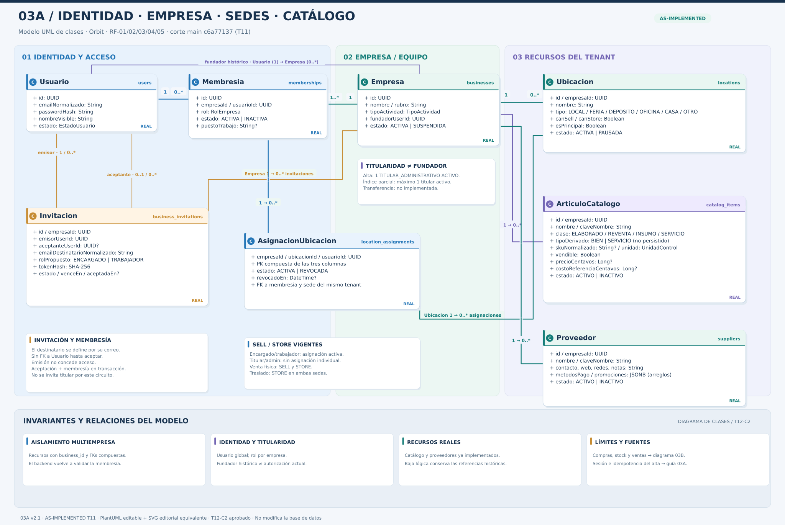

# 03A — Identity Guide, Companies, Locations, Catalogues and Suppliers

**Project:** Orbit — Generalistic multi-company and multi-rub management platform  
**Materia:** Programming 2 — UNSAM (2C2026)  
**Version:** 2.1 — **T12-C2** (approved and published in the documentary branch)  
**Date of cut:** 11 November 2026  
**Functional reference:** `main` en `c6a77137cf82dcb9aad225645e84b1265b1da3ec` (PR #45, T11).  
**Leading document:** [03 — Modelo de dominio y diagramas UML](../03_MODELO_DE_DOMINIO_Y_UML.md), **v2.1**, approved and published in the documentary branch of PR #46.  
**Files Associated:** [`03A_CLASSES_IDENTITY_Y_CATALOGO.puml`](03A_CLASES_IDENTIDAD_Y_CATALOGO.puml) y [`03A_IDENTITY_EMPRESSES_CATALOGO_REDISENATE.svg`](03A_IDENTIDAD_EMPRESAS_CATALOGO_REDISENADO.svg).

> **Scope and status:** this guide replaces the edition conceptually **v0.7 (E2-3, 08/11/2026)**. The eight main classes of the 03A are **AS-IMPLEMENTED** and they are persistent. **no** supposes that the functionalities outside RF-01 to RF-07 have real backend. T12-C2 is an exclusively approved documentary update: **only the three 03A files were published in the PR #46 branch; no code, database or `main`**.

## 1. Purpose, scope and rule of interpretation

The 03A responds **who is a person within the system, what companies can integrate, with what permissions it can act and what are the associated business resources**. Explains identity **global** and the company as **tenant** The same person can participate in several companies and have different roles in each.

Las **eight classes represented** are backed up by real SQLAlchemy models. Drawing fields use names **Conceptual in Spanish**, not the exact nomenclature of HTTP DTOs or Python attributes. `.puml` documents the complete associations; foil `.svg` combines fields for readability. Correspondence of both is checked in the following tables.

Purchases, receptions, balances, movements and sales are **implemented** on the backend of the cut T11; its structure corresponds to **03B**The use cases and the business actors correspond to the **03C**.

**It is not within this 03A:** the comprehensive physical ER, cash screens and financial accounts, QR REAL Market Payment, production with recipes/lots, reserves with item stock, transfer of ownership or complete audit of each historical change of allocation. The governing document separates that pending scope.

## 2. The eight REAL classes and their SQL correspondence

| Clase UML | Modelo SQLAlchemy / tabla | Relevant data and behaviour |
|---|---|---|
| `Usuario` | `User` / `users` | UUID; single standard mail; `password_hash`; visible name; status `ACTIVO`/`DESHABILITADO`; does not contain global business role. |
| `Empresa` | `Business` / `businesses` | Name, category, activity `PRODUCTOS`/`SERVICIOS`/`MIXTO`, `founder_user_id` and state `ACTIVA`/`SUSPENDIDA`. |
| `Membresia` | `Membership` / `memberships` | `business_id`, `user_id`, role, status `ACTIVA`/`INACTIVA`optional position; UNIQUE `(business_id,user_id)`. |
| `Invitacion` | `BusinessInvitation` / `business_invitations` | Company; mandatory issuer; recipient's email; proposed role; token SHA-256; validity; opt-in date and optional until accepted. |
| `Ubicacion` | `Location` / `locations` | Company, type, address/map, `can_sell`, `can_store`, `is_primary`, `ACTIVA`/`PAUSADA`. |
| `AsignacionUbicacion` | `LocationAssignment` / `location_assignments` | Primary key `(business_id,location_id,user_id)` and FKs composed of tenant headquarters and membership; state `ACTIVA`/`REVOCADA`. |
| `ArticuloCatalogo` | `CatalogItem` / `catalog_items` | Standard name, `kind`, unit, optional SKU, sellable, price/cost reference in cents, status and dates. |
| `Proveedor` | `Supplier` / `suppliers` | Name and `name_key`, contact references, networks, offers, JSONB media and promotions, status `ACTIVO`/`INACTIVO`. |

**Two actual technical tables that do not appear as central classes of this sheet:** `AuthSession`/`auth_sessions` (series and opaque token stored **Just like hash.**) y `BusinessCreationRequest`/`business_creation_requests` (Power of the senior business with PK `(actor_user_id,idempotency_key)`). Their exclusion is a decision of the **legibility of the business model**, not an assertion that they do not exist. Document 03 contains the full inventory of **19 models**.

### 2.1 Nomenclature: class, conceptual attribute and real SQL

| UML conceptual | Technical name implemented | Accuracy |
|---|---|---|
| `Usuario.emailNormalizado` | `users.email_normalizado` | Mail is standardized and unique globally. |
| `Empresa.fundadorUserId` | `businesses.founder_user_id` | History of creation; **no** exclusive source of permission and legal title. |
| `Membresia.rol` | `memberships.role` | `TITULAR_ADMINISTRATIVO`, `ADMINISTRADOR`, `ENCARGADO`, `TRABAJADOR`. |
| `Invitacion.emisorUserId` | `business_invitations.invited_by_user_id` | FK mandatory to global identity. |
| `Invitacion.aceptanteUserId` | `business_invitations.accepted_by_user_id` | Optional FK, populated when accepting. |
| `Invitacion.emailDestinatarioNormalizado` | `business_invitations.email_normalizado` | No FK required prior to `users`. |
| `Ubicacion.canSell / canStore` | `locations.can_sell / can_store` | Independent capacities. |
| `Ubicacion.esPrincipal` | `locations.is_primary` | Partial index of **maximum one** main active headquarters by company. |
| `AsignacionUbicacion.revocadoEn` | `location_assignments.revoked_at` | Consistent with its state; it does not keep all historical cycles. |
| `ArticuloCatalogo.clase` | `catalog_items.kind` | `ELABORADO`, `REVENTA`, `INSUMO`, `SERVICIO`. |
| `ArticuloCatalogo.tipoDerivado` | `CatalogItem.item_type` (property) | `BIEN`/`SERVICIO` **no** is additional SQL column. |
| `ArticuloCatalogo.claveNombre` | `catalog_items.name_key` | Standardisation with NFKC/casefold and singleness by company. |
| `ArticuloCatalogo.precioCentavos` | `catalog_items.price_cents` | `BIGINT` o `NULL`; no monetary calculation with float. |
| `Proveedor.claveNombre` | `suppliers.name_key` | UNIQUE `(business_id,name_key)` also for inactive. |
| `Proveedor.metodosPago / promociones` | `suppliers.payment_methods / promotions` | **Two JSONB fields of arrangement**, not a generic field `contacto_jsonb`. |

The entity `Supplier` also has SQL attributes such as `offerings`, `contact_person`, `phone`, `whatsapp`, `email`, `address`, `maps_url`, `website`, `instagram`, `notes` The SVG summarizes these attributes to avoid converting the class diagram into a dump of all columns.

## 3. Verifiable UML partnerships and multipleities

| Association | Cardinality | Royal/conceptual rule |
|---|---|---|
| `Usuario — Membresia` | User **1** ⇄ **0..*** Memberships | Each membership corresponds to a user; a user may not have a company. |
| `Empresa — Membresia` | Company **1** ⇄ **1..*** Memberships in a validly created company | The discharge transaction creates the first holder. **Minimum 1 is not imposed by an isolated FK or CHECK.** |
| `Usuario — Empresa` | Founding user **1** ⇄ **0..*** companies | Each company stores `founder_user_id` mandatory and historical. |
| `Empresa — Invitacion` | Company **1** ⇄ **0..*** Invitations | Every invitation belongs to a company. |
| `Usuario — Invitacion` (issuer) | Issuer **1** ⇄ **0..*** invitations issued | `invited_by_user_id` mandatory. |
| `Usuario — Invitacion` (acceptant) | Accepting user **0..1** ⇄ **0..*** accepted invitations | `accepted_by_user_id` is optional until acceptance. |
| `Empresa — Ubicacion` | Company **1** ⇄ **0..*** locations | The company is born with zero headquarters; it does not create fictitious deposit. |
| `Membresia — AsignacionUbicacion` | Membership **1** ⇄ **0..*** allocations | FK `(business_id,user_id)` towards the tenant membership. |
| `Ubicacion — AsignacionUbicacion` | Location **1** ⇄ **0..*** allocations | FK `(business_id,location_id)` to the tenant headquarters. |
| `Empresa — ArticuloCatalogo` | Company **1** ⇄ **0..*** Articles | Article always limited to a tenant. |
| `Empresa — Proveedor` | Company **1** ⇄ **0..*** suppliers | Optional supplier in purchases; company's own reference. |

**Reading of 0.1 vs. 0.*:** in the list of the acceptor of an invitation, **each invitation** zero or an accepting user, but **a user** Many invitations to different companies can be accepted. Multiply should not be reversed.

The business affiliation of `location_assignments` It is not just a documentary promise: the triple PK and composite FKs restrict cross-references. The backend also checks permissions; **FK correct does not amount to authorisation**.

## 4. Critical rules of the domain

### 4.1 Global user, session and ownership

When registering, a person gets a global identity with standardized email and password stored as hash. Commercial authorizations are resolved by means of **your active membership in the selected company** and not from a role in the table `users`.

Company creation saves Enterprise and initial Membership `TITULAR_ADMINISTRATIVO` **in the same transaction**. `founder_user_id` identifies a historical fact, not legal property, nor an independent authorization of the current membership. `uq_memberships_one_active_owner` sets **at most one ASSETS holder**, not mandatory existence of one in all possible SQL states.

Equipment editing service prevents **self-publishing** and the modification of role memberships `TITULAR_ADMINISTRATIVO`The acceptance of invitations cannot rewrite historical ownership. **No public ownership transfer implemented**; therefore, no supposed flow of transactional degradation is documented as if it existed.

Meetings (`AuthSession`) use opaque token and hash; the React REAL session is kept in memory of the client, so refresh (`F5`) requires re-authentication in the current court. A secure sessional persistence mechanism would be evolution **post-T12** and should not be confused with the design already implemented.

### 4.2 Invitation: identity, validity and acceptance

`BusinessInvitation` store `business_id`, mandatory issuer, recipient by email, `proposed_role` limited to **MANAGER** o **STAFF MEMBER**, token hashed, status, expiration and optional acceptance data. Possible states: `PENDIENTE`, `ACEPTADA`, `RECHAZADA`, `CANCELADA`, `EXPIRADA`.

Single partial index prevents two rows **PENDING** for the same `(business_id,email_normalizado)`. The expired date must be validated when using the invitation; it does not imply that an automatic task immediately changes its column `status`.

**CU-12:** invitation does not grant access. Acceptance requires authenticated user whose email corresponds and, in the same transaction, consumes the invitation and creates/reactivates Membership without doubling `(business_id,user_id)`.

### 4.3 Actual headquarters, assignments and permits

`Location` admite `LOCAL`, `FERIA`, `DEPOSITO`, `OFICINA`, `CASA`, `OTRO`; has `ACTIVA`/`PAUSADA`, contact attributes and capabilities `can_sell` y `can_store`. No headquarters are created when registering the company. If a head office is paused, it loses `is_primary`; reactivate it does not automatically recover that indicator. SQL allows **0 o 1** main active location in a tenant, does not require one.

`LocationAssignment` links a membership and location of the **same tenant**, is activated/revocated without physically deleting the row and does not grant a fifth role of enterprise.

**Policy SELL/STORE implemented:**

- `TITULAR_ADMINISTRATIVO` y `ADMINISTRADOR` can operate under headquarters capabilities without individual assignment.
- `ENCARGADO` y `TRABAJADOR` require **active membership and active assignment to that headquarters**, in addition to active enterprise/headquarters and appropriate capacity.
- **Receive goods:** STORE at the destination headquarters.
- **Move:** STORY in origin and destination, without transfer between companies.
- **Selling physical goods:** SELL **y** STORE about the sales headquarters, because confirmation also takes out stocks.
- **Services:** automatic output of inputs is not generated; the specific headquarters and role conditions are applied according to the command.
- **Manage purchase / stock start / settings:** Not all roles have identical powers. Creating purchase and fixing initial stock is the owner/manager; ordinary adjustments can admit maintainer according to service. Do not extrapolate these permits to worker.

These policies are used in the blocks **E2-4 (purchase/reception), E2-5 (stock), E2-6/E2-7 (sales POS)**. Guide v0.7 which called them "futures" is outdated.

### 4.4 Catalogue article

`CatalogItem` difference `kind` trade (`ELABORADO`, `REVENTA`, `INSUMO`, `SERVICIO`) del `item_type` derivative (`BIEN`/`SERVICIO`). The SKU, if reported, is unique within a company; the standard name is unique even when deactivating a token. Price and cost reference fields are whole in cents or `NULL`.

A tab `ACTIVO` does not imply that stock exists; **create catalog does not create balance**. The sales policy takes prices from catalogue and allows variations according to role: workers and managers cannot impose discounts or replace the current price with another value; an item without list price cannot be sold for those roles. The service-only item can be sold without discounting physical stocks.

Historical shopping and sales lines keep snapshots of description, type, unit, SKU and amount to avoid rewriting transactions already confirmed when the catalog is modified.

### 4.5 Real supplier, not TO-BE

`Supplier` already has a table `suppliers`, reading/editing logic and states **ASSETS/INACTIVE**. Uniqueness `(business_id,name_key)` also applies to inactive persons. Contact, networks, offers and commercial conditions are maintained; `payment_methods` y `promotions` son **JSONB arrangements** with structure and size restrictions.

In purchases the supplier is **optional**. When a purchase is associated with an active supplier of the same tenant, the commercial document retains `supplier_name_snapshot`. Disable or change the provider does not alter history. The stored payment conditions are **commercial descriptions**, no bank accreditations or a REAL integration with Mercado Pago.

## 5. Operational routes to explain in the defense

| Route | Outcome | Linking to the UML |
|---|---|---|
| CU-01/CU-02 | Global account registration and access | `Usuario` and technical session omitted from the main drawing. |
| CU-03 | Company and initial holder, not headquartered or stocked | `Usuario` (historical founder), `Empresa`, `Membresia`. |
| CU-12 | Safe invitation issuance/acceptance | `Empresa`, `Usuario` issuer/acceptant, `Invitacion`, `Membresia`. |
| CU-04 | High, editing and headquarters status; assignments | `Empresa`, `Ubicacion`, `AsignacionUbicacion`, `Membresia`. |
| CU-05 | High, query and edit of saleable sheet | `Empresa`, `ArticuloCatalogo`; normalisation and low logic. |
| CU-06/CU-07 | Purchase and subsequent physical reception | `Proveedor` (optional), `ArticuloCatalogo`, `Ubicacion` (destiny); full detail in 03B. |
| CU-08/CU-09/CU-11 | Balances, relocation and adjustments | `Ubicacion`, `AsignacionUbicacion`, `ArticuloCatalogo`; movements in 03B. |
| CU-10 | Sale in REAL, physical or service POS | `ArticuloCatalogo`, headquarters SELL/STORE, member of the actor; sale and payments in 03B. |

The system contemplates **multiple companies and items**WALOS is just one example; these classes should not be specialized for a pet shop.

## 6. Integrity: differentiation of SQL and services

| Guarantee | Persistent restriction | Additional validation of application |
|---|---|---|
| Unique identity | `uq_users_email_normalizado` | Standardization, password, current session. |
| Equipment without duplicates | `uq_memberships_business_user` | Allocations and protection of the holder. |
| Single active holder | Partial index `uq_memberships_one_active_owner` | Initial atomic creation; blocking of headline editions. |
| Invitations without duplicates pending | Partial index `uq_business_invitations_pending_email` | Overcoming, acceptance email, retrying. |
| Single active principal | Partial index `uq_locations_one_active_primary` | Transition `PAUSADA` and new main transactional. |
| Tenant allocations | Triple PK and composite FKs | Role, status and SELL/STORE permissions. |
| Single company SKU | Single partial index per `(business_id,sku)` when SKU is not `NULL` | Standardisation and article controls. |
| Single provider by company name | `uq_suppliers_business_name` | Standardisation, status and verification before purchase. |
| Historical transactions | FKs y snapshots en tablas comerciales | Atomic operations; no cascading history. |

**Important:** The "at most one" indexes do not mean "exactly one" at SQL level. The rule of having an initial holder results from the discharge operation. Roles are validated by company, not by a global ownership of `User`.

## 7. Difference between PlantUML, SVG and physical DER

The source `.puml` es un **Editable UML class diagram**, with the **eight classes and eleven associations** explicit and their multiplicity. `.svg` is a **vector representation editorial** of these same classes and associations: it simplifies or combines some fields in the box so that the text does not overflow. **It is not a literal rendering of PlantUML**; a PlantUML engine will redistribute the boxes if it is compiled directly.

To avoid false equivalence:

1. Both versions must show **`AsignacionUbicacion`**, unlike the old SVG, and retain issuer and acceptor of `Invitacion`.
2. Both must show **`Proveedor` as REAL** and catalogue/locations as resources already used by commercial operations.
3. Both must distinguish `item_type` derivative of SQL column and current title historical founder.
4. SVG's partnership lines use colours per theme and some orthogonal trajectories; they should be read by their **labels and ends**I don't eat new classes.
5. The source of truth for FKs, physical types, indices and complete columns are SQLAlchemy/Alembic; the **Post-T12 physical DER** can be generated from PostgreSQL with a tool such as DBeaver without replacing 03A.

Diagram not included `Supplier → Purchase` or other commercial associations with classes absent; this does not indicate that they do not exist. They develop in 03B. Likewise, the relationship `Empresa — Membresia` de **1 a 1..*** represents the validly created company's invariant, but SQL alone cannot guarantee that minimum using only FK of `Membership`.

## 8. Evidence and validation limits

**Base contrast:** SQLAlchemy models `User`, `Business`, `Membership`, `BusinessInvitation`, `Location`, `LocationAssignment`, `CatalogItem`, `Supplier`along with the policies and services of the court `main` `c6a77137`Document 03 v2.1 approved contains the largest inventory of 19 models, transactional operations and safety limits.

**Historical evidence T11** (not re-executed to create these sheets): integral QA pipeline GitHub Actions run 43015544889, with **892 Pytest, 38 Playwright REAL y 6 DEMO** The existence of such evidence does not replace the visual/semantic review of this new documentation.

**Publication Control:** the entities, associations and cardinalities of the `.puml` and its semantic equivalence with the editorial SVG, as well as the XML integrity of the latter. `.puml` con el motor PlantUML **outstanding** The proposed SVG was generated as a graphical vector and was visualised; it is not a direct export of the PlantUML engine.

## 9. What changed with respect to v0.7 (08/11/2026)

| Point | Previous version | Proposal T12-C2 |
|---|---|---|
| Supplier | Figure with future implementation/TO-BE | `Supplier`/`suppliers` **REAL**, standard name, contact and JSONB. |
| Trade | Projected purchase/inventory/sale | E2-4/E2-5/E2-6/E2-7 already implemented. |
| Sedes | SELL/STORE declared as futures | Capacity and allocation applied in real commands. |
| Headquarters allocation | In PlantUML, omitted from SVG | **Included in both** and associated with membership and location. |
| Invitation accepted | Optional link only in PUML | Issuer and acceptor visible in both representations. |
| Header | E2-3, 8/11/2026 | T12-C2, cut T11/11-11-2026, Document 03 v2.1. |
| PlantUML y SVG | No existing equivalence check | Partnership matrix and explicit rule of editorial simplification. |
| Meetings and powerlessness | Not always different from business | Documented real SQL support models, outside the central foil. |

**Correction to the support proposal:** the SVG v0.7 **yes contains visible class names and attributes**. The verifiable finding is that the editorial image was a **partial representation** in front of `.puml`, particularmente por la ausencia de `AsignacionUbicacion` and the optional acceptor. It is not correct to present it as an image without text.

## 10. Useful Questions for Academic Defense

**Why does User not have a role?** Because an identity can work for many companies, with different roles; `Membership` determines contextual access.

**What difference does it make between founder and holder?** The founder is an unchangeable historical UUID; the permits come from the current membership. The partial index avoids two active holders but does not require that there be one without service.

**Why an assignment class and not a simple relationship?** The member-head relationship has its own data (`status`, `revoked_at`) and needs composite FKs to validate the tenant. It is a real association with triple PK.

**Can a fair sell and store?** Sí, `can_sell` y `can_store` physical operation requires matching capabilities and assignment for operational roles.

**Why is Supplier in this diagram but Buy not?** 03A shows core business resources. Your optional participation in purchases and supplier snapshots are explained in 03B.

**Are payments saved on the Provider?** No: `payment_methods` contains referential business information. It does not represent reconciliation, accredited payment or Real Market Payment QR.

**Why not draw `AuthSession`?** It is preserved in PostgreSQL but it is authentication infrastructure, not a new conceptual relationship of catalog, headquarters or membership. Document 03 contains the technical tables.

## 11. Pending and approval criteria for T12-C2

- [x] Conciliation of SQLAlchemy classes, representative fields and main relationships against the T11 court.
- [x] REAL marked provider, contact attributes and JSONB arrangements.
- [x] Current application of SELL/STORE and role/assignment conditions.
- [x] `AsignacionUbicacion`, guest and acceptor reflected in the SVG editorial representation.
- [x] Documentation of classes omitted for reasons of scope (`AuthSession`, `BusinessCreationRequest`).
- [x] New vector SVG and raster preview for revision.
- [x] Visual confirmation and express user approval; no structural changes were requested.
- [ ] Syntax validation with a PlantUML executable (if not available in the environment, use the one installed by the computer).
- [x] Express approval and replacement of **three** Current archives of 03A in the documentary branch of PR #46.
- [ ] Later GitHub link control and cross-compromise with 03B/03C in T12-C5.

**Published:** Document 03 v2.1 and the frontend/backend/SQL code were retained unchanged. The three 03A files were replaced exclusively in the documentary branch of PR #46, which remains in DRAFT without meriting `main`The next step is **T12-C3: 03B — Purchases, receipt, inventory and sales**.
