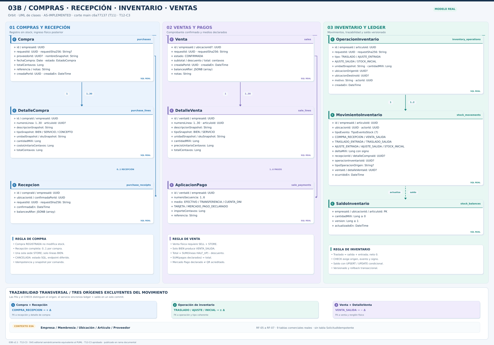

# 03B — Class Guide: purchases, receptions, inventory and sales

**Project:** Orbit — Generalistic multi-company and multi-rub management platform  
**Materia:** Programming 2 — UNSAM (2C2026)  
**Version:** 2.1 — **E2-7 / T12-C3**approved and published in the documentary branch  
**Documentary cut-off date:** 11 November 2026  
**Functional reference:** `main` en `c6a77137cf82dcb9aad225645e84b1265b1da3ec` (integration T11, PR #45)  
**Leading document:** [03 — Modelo de dominio y diagramas UML](../03_MODELO_DE_DOMINIO_Y_UML.md), version 2.1 approved in the documentary branch of PR #46  
**Supplementary diagram:** [03A — Identity, companies, offices, catalogues and suppliers](03A_EXPLICACION_IDENTIDAD_EMPRESAS_CATALOGO.md)version 2.1 / T12-C2  
**Editable source:** [03B_Classes_COMMERCIO_E_INVENTARY.puml](03B_CLASES_COMERCIO_E_INVENTARIO.puml)  
**Vector foil:** [03B_COMMERCIO_INVENTARY_REDIENT.svg](03B_COMERCIO_INVENTARIO_REDISENADO.svg).

> **Scope:** Documentation **AS-IMPLEMENTED** of the commercial modules effectively persisted in PostgreSQL, not a proposal for new tables or an execution of tests. This delivery replaces the conceptual edition **v0.3 TO-BE**03B describes commercial facts, balances and traceability; 03A describes identities, permits, locations, items and suppliers. **All three archives were approved and published in the documentary branch of PR #46; no merit was made `main`.**



## 1. What 03B is for and how to interpret it

The goal is to show how the platform registers **an purchase without creating stocks automatically**, **the physical receipt of that purchase**, **a justified change in stock** y **a confirmed sale**All these facts are isolated by company and retain historical data that should not be recalculated with the current catalogue.

The PlantUML source contains **nine persistent business classes** and four conceptual enumerations of restricted values, in addition to **five classes of reference to 03A**; these latter *are not new tables*. The editorial SVG shows the nine main classes and synthesizes cross-sectional associations using a band of leadger origins. To avoid an unreadable drawing, it does not list the 19 system tables or all FK to each external model.

**Essential difference:** el 03B es un **diagrama UML de clases** (relations and responsibilities), **not a DER generated from PostgreSQL**. The subsequent base ER display, for example with DBeaver, is an independent target **post-T12**. UML attributes are conceptually named in Spanish; the exact SQL column appears in the following correspondence.

## 2. Correspondencia clase UML ↔ SQLAlchemy ↔ PostgreSQL

| Clase UML | ORM | Tabla real | Principal responsibility |
|---|---|---|---|
| `Compra` | `Purchase` | `purchases` | High acquisition without immediate physical income. |
| `DetalleCompra` | `PurchaseLine` | `purchase_lines` | Historical line (good, service or free concept) and total calculated. |
| `Recepcion` | `PurchaseReceipt` | `purchase_receipts` | Confirmation **unique and complete** of physical property, to a headquarters. |
| `Venta` | `Sale` | `sales` | Confirmed check, totals and snapshot balances. |
| `DetalleVenta` | `SaleLine` | `sale_lines` | Line sold with price, quantity, type and historical description. |
| `AplicacionPago` | `SalePayment` | `sale_payments` | Average and amount **declared**, without external funds. |
| `OperacionInventario` | `InventoryOperation` | `inventory_operations` | Transfer, input/output adjustment or initial stock justified. |
| `MovimientoInventario` | `StockMovement` | `stock_movements` | **Ledger** of signed deltas and proven origin. |
| `SaldoInventario` | `StockBalance` | `stock_balances` | Current stocks per company–headquarters–article, versioned. |

**The context imported from 03A:** `Empresa` (`Business`), `Ubicacion` (`Location`), `ArticuloCatalogo` (`CatalogItem`), `Proveedor` (`Supplier`) y `Membresia` (`Membership`). An identifier `business_id` is the key to tenant separation; `Proveedor` That's it. **implemented**, no es TO-BE. `SolicitudIdempotente` **no** is included because **does not exist** a persistent generic table with that name.

### 2.1 Dictionary of attributes not to be confused

| UML | Column / actual contract | Relevant matiz |
|---|---|---|
| `Compra.requestId` y `requestSha256` | `purchases.request_id`, `request_sha256` | `request_sha256` admite `NULL` at model level for compatibility; new highs calculate hash. |
| `Compra.proveedorNombreSnapshot` | `purchases.supplier_name_snapshot` | String is not null; empty when no supplier was chosen. |
| `DetalleCompra.numeroLinea`, `articuloId` | `purchase_lines.line_number`, `catalog_item_id` | Number between 1 and 30; article **optional only in free CONCEPT**. |
| `DetalleCompra.tipoSnapshot` | `purchase_lines.kind_snapshot` | **`BIEN`, `SERVICIO`, `CONCEPTO`**; NO `ELABORADO/REVENTA/INSUMO`. |
| `DetalleVenta.tipoSnapshot` | `sale_lines.kind_snapshot` | **`BIEN` o `SERVICIO`**; mandatory article. |
| `DetalleCompra.skuSnapshot` / `DetalleVenta.skuSnapshot` | `purchase_lines.sku_snapshot`, `sale_lines.sku_snapshot` | String is not null; empty string is stored when there is no SKU. |
| `Recepcion.balancesAfter` | `purchase_receipts.balances_after` | JSONB arrangement for historical replay; **no** alternative balance. |
| `OperacionInventario.cantidadMilli` | `inventory_operations.quantity_milli` | Positive amount of operation; no column `cantidad_milli_snapshot` Separate. |
| `OperacionInventario.unidadSnapshot` | `inventory_operations.unit_snapshot` | Physical unit frozen. |
| `MovimientoInventario.tipoOperacionOrigen` | `stock_movements.operation_kind` | He participates in the FK composed with the operation and its type. |
| `MovimientoInventario.detalleCompraId` | `stock_movements.purchase_line_id` | Origin by **physical line** From reception. |
| `MovimientoInventario.detalleVentaId` | `stock_movements.sale_line_id` | Origin by **physical line** sales. |
| `Venta.balancesAfter` | `sales.balances_after` | Snapshot after sale, not inventory source. |
| `AplicacionPago.numeroSecuencia` | `sale_payments.payment_number` | Sequence between 1 and 6, unique within the sale/company. |
| `AplicacionPago.referencia` | `sale_payments.reference` | String is not null, empty by default; it is not verified banking number. |
| `SaldoInventario` | `stock_balances` | **PK triple** `(business_id, location_id, catalog_item_id)`; `version` Starts at 1. |

The original commercial classification of `CatalogItem.kind` (`ELABORADO`, `REVENTA`, `INSUMO`, `SERVICIO`) yes it is in the 03A; the snapshot `kind_snapshot` in a detail represents his **physical behaviour** (`BIEN`/`SERVICIO`) or the absence of an article (`CONCEPTO` This distinction avoids documenting columns and restrictions that are not available.

## 3. Relations, multiplicity and scope of KFs

| Relationship | Cardinality of a Valid API Record | Sustent and accuracy |
|---|---|---|
| `Compra — DetalleCompra` | **1 → 1..30** lines | FK `(business_id,purchase_id)`, single numbering; minimum lines are required by the command contract. |
| `Compra — Recepcion` | **1 → 0..1** reception | `uq_purchase_receipts_business_purchase`; there is no partial/multi-destiny reception. |
| `Proveedor — Compra` | **1 provider → 0..*** purchases; **purchase → 0.1** supplier | Optional provider, business FK; your name is frozen when you register. |
| `Venta — DetalleVenta` | **1 → 1..30** lines | Business FK and single number per voucher. |
| `Venta — AplicacionPago` | **1 → 1..6** declared payments | FK and sequential number; the limit/minimum is validated in API. |
| `OperacionInventario — MovimientoInventario` | **1 → 1 o 2** movements | Transfer: exactly two; initial adjustments/stock: one, by controlled creation in service. |
| `Recepcion — MovimientoInventario` | **0..1** reception by movement; **0..*** movements by reception | Only physical lines `BIEN`with FK for reception and detail. |
| `Venta — MovimientoInventario` | **0..1** sale by movement; **0..*** sales movements | Physical lines only; FK triple to `sale_lines` identifies the sale and line. |
| `MovimientoInventario → SaldoInventario` | **No direct FK multiplicity** | Dependencia **transactional** per triple company–location–article, not FK moving to a PK of mandatory balance. |

**Do not read UML lines as SQL warranty for all minima.** In PostgreSQL there is no parent CHECK that automatically counts the child lines; the service creates the full aggregate. Similarly, it is not claimed that a FK of `purchase_line_id` prove by itself that the line corresponds to the purchase of `receipt_id`: the selection of the aggregate and its consistency are controlled when executing the reception.

**Insulation:** the FK composed with `business_id` prevent multiple cross-referenced physical, and services must authorize the session, membership and venue. **A valid FK does not grant permission.**

## 4. Shopping: registering does not mean reception (RF-05, CU-06)

`Purchase` save company, optional supplier, supplier history name, date, author, status, reference, notes, total and idempotence. `PurchaseLine` retains description, type, unit, SKU, quantity and cost agreed. API **calculates** the total by adding individually rounded lines.

**Current flow:** a purchase is recorded with physical items and/or services/concepts not yet chosen destination. In this operation **no se crea `StockMovement` does not alter `StockBalance`**. The destination is decided later, at the reception.

| State permitted by `ck_purchases_status` | Actual meaning |
|---|---|
| `REGISTRADA` | There is at least one physical good pending reception. |
| `RECIBIDA` | Full physical reception was confirmed at a headquarters. |
| `CERRADA_SIN_RECEPCION` | Only services/concepts; never receive movements are created. |
| `CANCELADA` | **State admitted by CHECK, no public cancellation endpoint in court T11.** Don't invent transition. |

A mixed purchase only receives lines `BIEN`. The supplier must belong to the company and be active when registering the purchase; a subsequent modification of its name **no reescribe** `supplier_name_snapshot`. A free concept lacks `catalog_item_id`and should not become an implicit physical article.

## 5. Reception: a physical income, a headquarters and a commission (CU-07)

`PurchaseReceipt` relates a purchase `REGISTRADA` con **one active location with STORE capacity**. Operating authorization by headquarters is checked in the service: holders/administrators can operate without individual assignment; managers/workers require the enabling assignment according to the corresponding policy.

1. Revalidate session, company, membership, purchase and capacity STORE of the chosen headquarters.
2. Lock/check the purchase and confirm that there is no prior receipt.
3. Identificar **all** the physical lines of purchase and revalidate its applicable unit/type.
4. Insert reception (`request_id`, hash, actor, date, `balances_after`) and credit balances per item with UPSERT secure.
5. Insert `StockMovement` of a kind `COMPRA_RECEPCION` **by physical line**, con `receipt_id` y `purchase_line_id`.
6. Mark purchase `RECIBIDA` and confirm **all together**; any exception involves rollback.

The index `uq_purchase_receipts_business_purchase` constitutes the last barrier against a second reception for such purchase. `balances_after` preserves *backed balances/versions in the original response* even if inventory changes later. It is not an editable balance.

**Not implemented:** partial reception, multiple venues for the same purchase, receipt of inputs automatically linked to recipes, reconciliation of purchase payment.

## 6. Inventory: operation, movement and balance are different concepts (RF-06)

### 6.1 Inventory operation (`inventory_operations`)

`InventoryOperation` records an identifiable, justified and idempotent manual action. `source_location_id` y `destination_location_id` are optional in the model but restriction `ck_inventory_operations_direction_locations` requires a combination according to `kind`:

| `kind` | Headquarters | Headquarters | Events | Consequence |
|---|---|---|---|---|
| `TRASLADO` | Mandatory | Mandatory and Different | `TRASLADO_SALIDA`, `TRASLADO_ENTRADA` | Two opposite deltas; net variation 0. |
| `AJUSTE_ENTRADA` | NULL | Mandatory | `AJUSTE_ENTRADA` | Justified entry. |
| `AJUSTE_SALIDA` | Mandatory | NULL | `AJUSTE_SALIDA` | Justified discharge, requires sufficient balance. |
| `STOCK_INICIAL` | NULL | Mandatory | `STOCK_INICIAL` | First load controlled without previous history. |

The amount `quantity_milli` es **positiva** in the operation; the sign is expressed by the **delta** The unit, the article and the headquarters are validated. A transfer to the same office is not allowed.

**Permits in force:** for positive/negative adjustments, the service allows holder/manager/charger under STORE policies; `TRABAJADOR` does not make adjustments. `STOCK_INICIAL`, only holder/manager. Transfers and receptions require STORE capacity at the locations involved and effective authorization by location. Authorization is application logic and not a ownership of a CHECK SQL.

**Physical count and `expected_version`:** the setting command carries an observed version to reject balances that have changed concurrently; **`expected_version` no es columna de `inventory_operations`**. If the count matches the observed balance, it is not appropriate to generate a fictitious movement.

### 6.2 Historical movement book (`stock_movements`)

The leadger stores stock facts *with sign*. `ck_stock_movements_origin_and_sign` checks that **type of event, origin identifiers and sign** they correspond, not simply that one of three FK is different from NULL.

| `event_type` persisted | Mandatory origin | Delta | Effect |
|---|---|---|---|
| `COMPRA_RECEPCION` | `receipt_id` + `purchase_line_id` | Positive | Well received. |
| `TRASLADO_SALIDA` | `inventory_operation_id` + `operation_kind=TRASLADO` | Negative | It's off the record. |
| `TRASLADO_ENTRADA` | Same operation and class | Positive | It's credited to the destination. |
| `AJUSTE_ENTRADA` | Type operation `AJUSTE_ENTRADA` | Positive | Justifiable adjustment. |
| `AJUSTE_SALIDA` | Type operation `AJUSTE_SALIDA` | Negative | Justifiable adjustment. |
| `STOCK_INICIAL` | Type operation `STOCK_INICIAL` | Positive | Initial charge. |
| `VENTA_SALIDA` | `sale_id` + `sale_line_id` | Negative | Well-physically sold. |

Composite FKs verify tenant, and `fk_stock_movements_operation_kind_tenant` even the **class of manual operation**. The Oneness `uq_stock_movements_receipt_line`, `uq_stock_movements_operation_event` y `uq_stock_movements_sale_line` prevent duplication according to origin. **There's no column. `motivo` generic in `stock_movements`:** the reason for a manual operation is found in `inventory_operations.reason`.

**Ledger auditable** means that applications should not rewrite old moves to correct stocks; a correction needs a new authorized fact. It does not imply stating that PostgreSQL has a generic trigger that makes all rows physically immutable in front of any privileged access.

### 6.3 Transactional balances (`stock_balances`)

La **Three-part PK** `(business_id, location_id, catalog_item_id)` identifies the unique balance of a property at a headquarters and company. SQL requires `quantity_milli` non-negative and one `version` Positive. A still non-existent row is interpreted as zero when attempting an output. For a first entry the service uses concurrent UPSERT; to discount, atomic conditions of availability, for example `UPDATE ... WHERE quantity_milli >= cantidad`.

When recording a move, the materialized balance and ledger are updated in the same commit. The balance is not considered an editable article freely nor must it be re-recounted on the frontend to apply changes. The expected logical reconciliation is:

```text
Saldo actual (empresa, sede, artículo)
    = suma de delta_milli de sus movimientos confirmados
```

This conciliation is a **systemic invariant retained by services**, not a CHECK SQL that adds historical rows. Version validation and proof of continuance should use actual PostgreSQL and independent sessions.

## 7. Sales and payments declared (RF-07, CU-10)

### 7.1 Sales and its lines

`Sale` persists **only `CONFIRMADA`**; there is no SQL entity for cart or commercial draft. `SaleLine` save your required item and the snapshots of name, physical class, unit, SKU, quantity and price agreed. It has line numbers 1 to 30.

**Real backend sales flow:**

1. Check session and active membership in an Active Company; validate authorization for the location of the sale.
2. Check that the catalogue is ASSISTANT, `sellable` and that units/quantities are compatible.
3. Apply **price policy per role (T10/T11)**: `ENCARGADO` y `TRABAJADOR` cannot change list price or apply discounts. For them it is required `catalog_items.price_cents` The backend revalidates, regardless of the input status in React.
4. Calculate total of **each line** with HALF_UP and then the subtotal and discount. Check that the sum of payments declared matches the total.
5. Grouping amounts of the same physical good **only to control and discount stock**; preserve each line and its historical amount.
6. For physical sale: demand headquarters with **SELL + STORE** and sufficient stock, with active operator allocation where appropriate.
7. Insert sale, lines, declared applications, movements of `VENTA_SALIDA`, update of balances and `balances_after` en **one transaction**; if stock is missing, no sale or partial payment remains.

**Sale of services only:** does not produce physical discharge and may omit headquarters only for holder/manager. An operating role without a head office cannot confirm sale. **Mixed sale:** accounts only for assets `BIEN`not services or inputs automatically.

### 7.2 Declared means (`sale_payments`)

| Medium persisting | Meaning |
|---|---|
| `EFECTIVO` | The operator declared cash. |
| `TRANSFERENCIA` | Declaration of a transfer, not bank reconciliation. |
| `CUENTA_DNI` | Declaration of half a DNI ACCOUNT. |
| `TARJETA` | Declaration of payment by card. |
| `MERCADO_PAGO_DECLARADO` | Manual declaration; **no** QR or webhook proof confirmed. |

The total commercial can be distributed to **1 y 6** The sequence number is unique within the sale. **There are no company financial accounts, persistent daily cash, settlement of payments or real OAuth/QR connection for payment market.** These integrations are left for a post-T12 increase.

### 7.3 Sales consultation and visibility

The historical query does not give unrestricted permissions to the author. Owner/Manager may consult sales of the company under their membership; maintainer/worker only see sales of headquarters to which they currently have an active assignment. A revocation can remove visibility over previous sales. Stock reading has its own rules; it is not correct to automatically extrapolate sales policy to any inventory.

## 8. Accurate monetary arithmetic and limits

The amounts are **wholes of cents**, the quantities are **100ths of the unit of the article** and applied rounding **HALF_UP by line**.

```text
line_total_cents = floor((quantity_milli × unit_price_or_cost_cents + 500) / 1000)
Compra.total_cents = Σ PurchaseLine.line_total_cents
Venta.subtotal_cents = Σ SaleLine.line_total_cents
Venta.total_cents = subtotal_cents - discount_cents
Σ SalePayment.amount_cents = Venta.total_cents
```

Illustrative mathematical example: three lines separately from `0,333` unit a `10,50` per unit (1,050 cents) generated **350 cents per line and 1,050 cents in total**. If they are grouped `0,999` units and only after it was rounded, the total would be **1,049 cents**That's why the backend **group physical quantities for stock**but **does not merge lines to bill**.

`PurchaseLine` supports unit cost 0 and the header may have total 0. `SaleLine` supports price per line 0 as a bonus, but `Sale` requires **Subtotal and total final strictly positive**. For discrete items (`UNIDAD`, `PAQUETE`, `CAJA`; y `SERVICIO`/`CONCEPTO` where applicable), the amount must be multiple of 1,000 thousandths. SQL controls the arithmetic of each line; the sum of multiple rows and payments is verified in the application layer.

## 9. Actual Impotency per Aggregate; No Generic Table

The command identity is sent to `Idempotency-Key` as UUID and is kept in its respective entity:

| Command | Persistence of `request_id` y hash | Observable rule |
|---|---|---|
| Crear compra | `purchases`, UNIQUE `(business_id, request_id)` | Replay same actor+body; another content/actor conflicts. |
| Confirm receipt | `purchase_receipts`, UNIQUE `(business_id, request_id)` | Replay of the received already confirmed; does not re-enter stock. |
| Move / adjust / initial stock | `inventory_operations`, UNIQUE `(business_id, request_id)` | Replay of the operation, no second move. |
| Confirm sale | `sales`, UNIQUE `(business_id, request_id)` | Replay of voucher without new departure or payment. |
| Create company | `business_creation_requests` with PK `(actor_user_id, idempotency_key)` | The mechanism of the firm's discharge is documented in 03A/Document 03. |

El **par** `request_id` + `request_sha256` and the validation of the actor help to distinguish a legitimate retry from a conflictive reuse of key. **by table/aggregate**, not as a unique global key between purchase and sale. Application hashes are not password hashes or money accreditations.

**If confirmed in DB but lost HTTP response**, the client must recover the existing result, **do not re-create the transaction**. In sales the backend displays consultation by `request_id`: `GET /api/v1/businesses/{business_id}/sales/by-request/{request_id}`. The guide does not assume that every screen already implements an automatic recovery after timeout. The UX verification before retry and the typed error messages are post-T12 tasks.

## 10. Integrity: PostgreSQL restrictions against service rules

| Critical rule | Implementation / limit |
|---|---|
| Purchase by request | `uq_purchases_business_request`, more digest/actor in service. |
| Single reception per purchase | `uq_purchase_receipts_business_purchase`More lock and lock. |
| Event by physical line | `uq_stock_movements_receipt_line` y `uq_stock_movements_sale_line`. |
| Event per operation | `uq_stock_movements_operation_event`, más `operation_kind` coherent. |
| Origin and sign of movement | `ck_stock_movements_origin_and_sign`; requires allowed combinations of identifiers/type/sign. |
| Non-negative/versioned balances | `ck_stock_balances_quantity_nonnegative`, `ck_stock_balances_version`; `UPDATE` conditional/UPSERT. |
| Direction of transfers and adjustments | `ck_inventory_operations_direction_locations` and headquarters checks, permits and catalogue. |
| Accuracy per line | `ck_purchase_lines_half_up_total`, `ck_sale_lines_half_up_total`; service is calculated in cents. |
| Confirmed and total consistent sale | `ck_sales_status_confirmed`, `ck_sales_positive_total_equals_subtotal_minus_discount`. |
| Payments and total amount | `sale_payments.method` restricted in `ck_sale_payments_declared_method`; **amount between payments** validated by service. |
| Multi-company | FK composed of `business_id` and tenant-scoped queries; permission authorized in each service. |

In particular, a properly related base **does not remove** the risk of authorization if the server fails to validate permissions. `Sale` does not automatically check the sum of N records `SalePayment`.

## 11. Relevant concurrence and cases of error

**Two sales of the last unit:** the server must allow one to confirm and another to fail without negative stock. **no sale, payments or partial movements**. The difference between making a SELECT and a `UPDATE` atomic conditional is essential to show why the balance is safe.

**Two receptions of a purchase:** a single reception can persist, even if the requests have different keys; it is not accepted to double credit the same physical purchase.

**Balance initially absent:** physical output without row equals 0 and failure; initial positive input uses concurrent UPSERT.

**Transfer plus concurrent sale:** origin is debited and accredits destination within the same commit that records both transfer facts; a competing sale should not leave inconsistency.

**Counting with obsolete version:** `expected_version` does not match and the service rejects operation. The settings router returns **409** with text ‘Version of obsolete balance or non-existent balance’, not a field `code: STALE_BALANCE_VERSION` confirmed.

**Accesses from another company/headquarters:** a valid UUID of an external business does not enable operation; an unallocated contributor to STORE/SELL does not access that function at that location.

These are **verification scenarios and evidence**This documentary work does not perform new load tests, Pytest, Playwright or migrations: do not present it as a new result IC of T12-C3.

## 12. Model-related REST API

Common prefix: **`/api/v1/businesses/{business_id}`**. The information of registration, editing and permissions of suppliers/catalogue/headquarters resides in 03A.

| Documented REAL Operation | Method and route | CU |
|---|---|---|
| Create and Consult Shopping | `POST /purchases`, `GET /purchases`, `GET /purchases/{purchase_id}` | CU-06 |
| Receive and consult voucher | `POST /purchases/{purchase_id}/receive`, `GET /purchases/{purchase_id}/receipt` | CU-07 |
| Transfer and consultation | `POST /inventory/transfers`, `GET /inventory/transfers/{transfer_id}` | CU-09 |
| Adjustment and consultation | `POST /inventory/adjustments`, `GET /inventory/adjustments/{adjustment_id}` | CU-11 |
| Confirm / list / consult sales | `POST /sales`, `GET /sales`, `GET /sales/{sale_id}` | CU-10 |
| Recovery from sale by command | `GET /sales/by-request/{request_id}` | CU-10 |

**Route note:** This selection is not intended to be the full inventory of the project API. Balance/movement queries and other resources management are described in its modules and contractual documents; do not add imaginary cancellation endpoints, cashier or external QR.

## 13. Relationship to 03A, Document 03 and future visualization of the base

El 03B **no duplicate** the business classes of 03A. For all operations, your `business_id` defines the undertaking; `catalog_item_id` reference to a real sheet; `location_id` represents a headquarters with capabilities; `supplier_id` is optional for purchases; `created_by_id` / `actor_id` are associated with the tenant's membership.

Document 03 v2.1 is the guiding source of definitions, 03A shows base entities, 03B shows commercial facts and 03C will show cases of use and actors. After T12 it is proposed to generate **a physical DER from PostgreSQL real** with a tool like DBeaver, without migrating the base or replacing UMLs by a diagram of tables that are foreign to the contracts implemented.

**On the SVG:** is an editorial design **semantically equivalent** to the nine central classes of the PUML, not a result automatically exported by PlantUML. `Recepcion` y `Venta` towards `MovimientoInventario` are represented in the lower traceability band to avoid lines that pass through cards. `Empresa`, `Proveedor`, `Ubicacion`, `ArticuloCatalogo` y `Membresia` are listed as a context from 03A, not new persistences of 03B.

## 14. Decisions postponed — do not confuse DEMO with REAL

- **REAL/DEMO Convergence:** maintain backend operations and security, bring navigation, aesthetics, visual validations and realistic frontend usage sequences closer to existing DEMO screens.
- **Web/mobile demo:** prepare a React/Vite experience responsive and reproducible for teaching use and testing in browser or phone, without certifying a safe public deployment.
- **ER diagram of the actual scheme:** derive it from PostgreSQL with DBeaver, dbdiagram or other tool; it is additional physical representation, not substitution of this UML.
- **Market Real QR Payment:** each company will connect its **own account**; distinguishing **Article QR** (identification/link) of **QR collection** (transaction), confirm payments via verified providers/webhooks and implement specific idempotency. `MERCADO_PAGO_DECLARADO` hoy **He doesn't do that job.**.
- **Cash, expenses, financial accounts, reserves/payments with sign and input consumption automation:** may be included in DEMO or the plan, but are not attributed to these nine persistent models without additional code/migration and testing.

The inclusion of this road map **does not change academic acceptance criteria** does not authorize functional work on the repository during T12-C3.

## 15. Key Questions for Oral Defense

**Why separate Purchase from Reception?** Because acquiring does not mean physically disposition. The purchase retains the commitment and receipt represents the income of goods in a specific venue, with date and actor.

**Why is there `StockMovement` y `StockBalance`?** The first is the auditable history of events; the second is the queryable and blockable projection. They sync atomically, without duplicating an editable source of truth.

**What prevents double reception or double sale by retry?** SQL uniqueness by addition and command key, digest/actor verification and a single transaction. Double receipt is also restricted by purchase.

**What does it protect against overselling?** Conditional discount with sufficient balance in PostgreSQL and full rollback in case of conflict.

**Why are prices and descriptions snapshots?** To avoid rewriting historical vouchers when the catalog or supplier changes. The unit price of selling operational roles is also validated against catalog in backend.

**Why `MERCADO_PAGO_DECLARADO` does not equal Market Payment QR?** Because declaring the media manually does not consult or verify an external processor recovery order. Real integration requires company credentials, verification of notifications, payment statements and reconciliation.

**What patterns can be defended?** Service Layer, Repository where it exists, transactional handling through the SQLAlchemy session, historical snapshots and idempotency/replay. Do not claim that there are GoF classes `State`, `Memento` a universal implementation of `UnitOfWork` when the code doesn't display them.

## 16. Traceability matrix and deliverable checks

| Area | Requirement / CU | Table/evidence of code | Expected documentary result |
|---|---|---|---|
| Purchase | RF-05 / CU-06 | `Purchase`, `PurchaseLine`, Shopping service | No physical income when creating; snapshots and correct states. |
| Receipt | RF-05 / CU-07 | `PurchaseReceipt`, `StockMovement`, `StockBalance` | A physical reception by purchase, a STORE headquarters, entrance by line. |
| Inventory and consultation | RF-06 / CU-08 | `StockBalance`, `StockMovement` | Triple stock and ledger, history and reconciliation. |
| Transfer | RF-06 / CU-09 | `InventoryOperation`Two moves. | Atomic output and input, net zero. |
| Adjustment/counting | RF-06 / CU-11 | `InventoryOperation`, version of balance | Roles, motive and control of attendance. |
| Sale | RF-07 / CU-10 | `Sale`, `SaleLine`, `SalePayment` | Confirmed check, declared payments and atomic physical discharge. |
| Context | RF-01..05 / 03A | `Business`, `Membership`, `Location`, `CatalogItem`, `Supplier` | Tenant, permits, headquarters, catalog and actual supplier. |

**Acceptance list T12-C3 (completed after revision):**

- [x] The modeled **9 persistent commercial entities**.
- [x] The PlantUML declares 4 purchase statements, 4 types of transactions, 7 ledger events and 5 declared payment means.
- [x] The diagram/guide does not invent an SQL table `SolicitudIdempotente`.
- [x] Se identifica `Purchase.request_sha256` as nullable in the model and `kind_snapshot` With the right guys.
- [x] Explanations `operation_kind`, the identifiers per line and the origin/event/sign of movement rule.
- [x] SQL CHECK/FK/UNIQUE is distinguished from transactional validations of the service.
- [x] Declared payment of accredited QR is distinguished; post-T12 objectives are retained.
- [x] The editorial SVG is legible; all 156 labels `<text>` have attribute `fill` explicit and retain their approved design.
- [ ] Validate syntax of `.puml` with a **motor PlantUML** (if not available, enter it without inventing result).
- [x] Human and **express approval** of the three files to replace them in PR #46.
- [x] Update **only** `.puml`, `.svg` and this guide in `docs/e2-7-t12-cierre-academico`; verificar commit y referencias, sin tocar `main`, frontend, backend ni DB.

**Opinion:** **T12-C3 ADOPTED AND PUBLISHED IN DOCUMENTAL RAM**, derived from functional cut T11 and compatible with Document 03 v2.1/03A v2.1. PR #46 remains DRAFT; not merged to `main`. The compilation with PlantUML is still pending due to lack of executable in this environment. The next documentary increase is **T12-C4 — 03C, use cases**.
