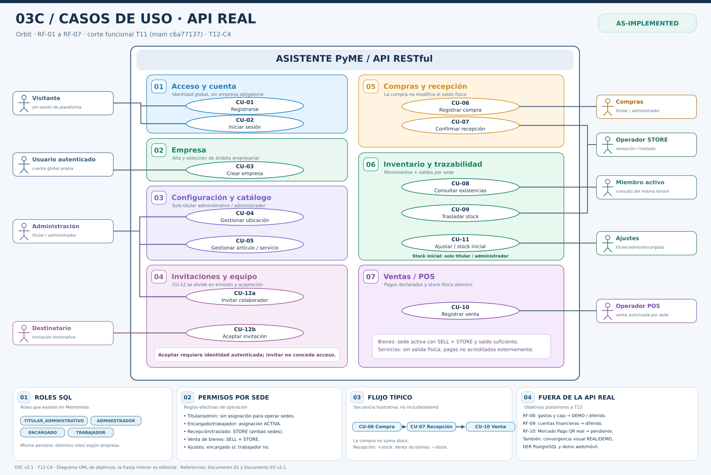

# 03C — Real API Use Case Guide

**Project:** Orbit — a generalist multi-company and multi-rub platform.  
**Materia:** Programming 2 — UNSAM, second quarter of 2026.  
**Version:** **2.1 / E2-7 T12-C4**approved and published in documentary branch.  
**State of representation:** **AS-IMPLEMENTED T11** from the RF-01 to RF-07 core.  
**Functional cut:** rama `main`, commit `c6a77137cf82dcb9aad225645e84b1265b1da3ec` (PR #45).  
**Rama documental:** `docs/e2-7-t12-cierre-academico` (PR #46, **DRAFT**); **the three 03C files were approved and published**.  
**Reference documents:** [01 — Requirements](../01_ANALISIS_DE_REQUERIMIENTOS.md), [02 — Cases of use](../02_CASOS_DE_USO.md), [03 — Domain model v2.1](../03_MODELO_DE_DOMINIO_Y_UML.md) y [05 — API matrix and traceability](../05_MATRIZ_API_Y_TRAZABILIDAD.md).

[See vector SVG sheet](03C_CASOS_DE_USO_REDISENADO.svg) · [Ver PlantUML editable](03C_CASOS_DE_USO.puml) · [03A — Identity classes and catalogue](03A_EXPLICACION_IDENTIDAD_EMPRESAS_CATALOGO.md) · [03B — Trade and inventory](03B_EXPLICACION_COMPRAS_INVENTARIO_VENTAS.md).

> **How to read the diagram:** the foil presents the **objectives of the actors** of the real API, not PostgreSQL tables or mandatory path of each request. The operational profiles drawn are *contextual functions*; the only role names persist in `Membership.role` son `TITULAR_ADMINISTRATIVO`, `ADMINISTRADOR`, `ENCARGADO` y `TRABAJADOR`. Effective authorization is checked on the backend by user, session, membership, company and, where appropriate, headquarters. REAL state does not mean that the deferred capabilities are already developed.

## 1. Purpose, scope and corrections compared to the previous version

The diagram answers three questions: **who interacts with Orbit**, **what objectives the REAL MVP can achieve** y **which business controls separate those objectives**. Its border is labeled `Orbit / API RESTful`; API is **part of the system**Never an outside actor.

This version replaces the historical state in documentary form `03C v0.3 / TO-BE` (design prior to the integration of backend) by a representation of the CUs **effectively implemented** in FastAPI, SQLAlchemy/PostgreSQL and the React REAL screens at cut T11. Document 03 rector v2.1 and diagrams 03A and 03B constitute their architectural context; their classes are not duplicated as actors of the case-use diagram.

The editorial sheet organizes the cases by areas to facilitate oral defense. Colored pictures are **thematic clusters** And the ovals are **cases of use UML**. The partnership lines indicate an actuating function that participates in the objective; **no** the lower strip of commercial flow represents a **illustrative sequence**, not an "include", "extend" or "inheritance" UML relationship or obligation to complete all cases of use.

### 1.1 Ratio of 12 CUs written to 13 ovals

El Documento 02 define **CU-01 a CU-12** (twelve specifications). **CU-12a Invite** y **CU-12b Accept** because they are objectives initiated by different people; that is why there are **13 ovals**, without inventing a CU-13. Other extensions already implemented (manage locations, collaborators, check vouchers and catalog status) are operations of existing CUs and do not require artificial numerations.

## 2. Actors and their equivalence with real roles

| Functional Actor in 03C | What it represents | Checkable matching in implementation |
|---|---|---|
| **Visitor** | Person without session wishing to register or authenticate | No business membership required; CU-01 and CU-02 |
| **Authenticated user** | Active global account creating your first business or other additional | `User` + `AuthSession`; CU-03 crea `Business` and initial membership |
| **Administration** | Person managing configuration, catalog and invitations within a company | `TITULAR_ADMINISTRATIVO` o `ADMINISTRADOR`; active membership and company enabled to write |
| **Purchases** | Responsible for recording procurement and its lines | **Alone** holder/manager to create purchases; CU-06 **no** location required when registering |
| **Operator STORE** | Authorized function for receiving goods or moving goods between headquarters | Holder/admin without individual assignment; maintainer/worker with `LocationAssignment` ACTIVA and STORE-fitting headquarters |
| **Active member** | User who consults balances and business movements | The four active membership roles can consult the same tenant inventory (CU-08); reading does not grant right to operate at another venue |
| **Adjustments** | Responsible for making justified adjustments or initial stock loading | Adjustments: holder/admin/**Maintainer**; **original stock exclusively holder/admin**; worker excluded from both |
| **Operator POS** | Person authorised to register sales in your company | Holder/admin or manager/worker with the relevant headquarters and pricing policy conditions |
| **Addressee** | Authenticated user whose mail matches the directed invitation | Accepts valid invitation and creates/reactivates your membership only once; you do not get access just by receiving the link |

**Important:** The same user can be a holder in one company and a manager in another; there are no persistent "OperatorBuyers", "Seller" classes or SQL roles with those names. In the film, the actor "Buys" is a *function label*, not the declaration of a fifth role. **Supplier** y **buyer customer** Nor are they authenticated by the mere fact that they appear as commercial data.

### 2.1 Killings of permissions that should not be missed

- **PORTOPERATORY_ACMINISTRATIVE:** broad business authorization; the system protects ownership against ordinary editing/revocation. It should not be confused historical founder with current active role.
- **Role Administrator:** manages company/configuration, catalogue, purchases and invitations; **does not equal holder** for all management of protected memberships.
- **Role in charge:** may operate locations assigned to SELL or STORE and make justified adjustments, but no initial stock or override of sale price or discount.
- **Rol WORKER:** may operate locations assigned to SELL or STORE and execute permitted receptions/transfers/sales; **cannot record adjustments or initial stock**, nor modify price or discount of the POS.
- **Status:** writing requires active company/membership and, for operation by headquarters, active location. **no personal assignment required**, although the required headquarters capabilities. Manager/worker require active assignment to each headquarters involved.

## 3. Matrix of use, roles and policy cases by location

| CU | REAL Objective | RF | Who can start it? | Relevant authorisation condition |
|---|---|---|---|---|
| **CU-01** | Sign up | RF-01 | Visitor | Standardised single mail; does not create business or membership automatically |
| **CU-02** | Start/Close Session, Consult Identity | RF-01 | Visitor for login; session holder for `/me` y logout | Authentication Opaque Bearer; token in memory of the REAL frontend |
| **CU-03** | Create and manage a company | RF-02 | Authenticated global user to create; members authorized for later management | High atomic enterprise + titular membership; own high-level business power |
| **CU-04** | Create/Edit/pause headquarters and manage assignments | RF-03 | Holder or administrator for high/editions | Insulation by company; indicators `can_sell`, `can_store`; a maximum active principal |
| **CU-05** | Create/Edit/disable article or service | RF-04 | Write holder or administrator | Catalogue file by company; SKU/name checked; **no crea stock** |
| **CU-06** | Register purchase | RF-05 | **Holder or administrator** | No home address required; snapshots; no inventory change |
| **CU-07** | Confirm full reception | RF-05, RF-06 | Holder, administrator, manager or worker | **STORE** at destination headquarters; for manager/worker, active assignment; a full receipt by purchase |
| **CU-08** | Check balances and movements | RF-06 | The four roles with active membership | Tenant reading; may include balances from multiple locations even if the member is unable to operate them |
| **CU-09** | Move stocks | RF-06 | Holder, administrator, manager or worker | **STORY at origin and destination**, active site(s); active operator assignment to both; a debit and an atomic credit |
| **CU-10** | Register sale POS | RF-07 | Holder, administrator, manager or worker | For physical property: same headquarters **SELL + STORE**, sufficient stock and allocation if applicable. For manager/worker: price of the compulsory catalogue, without change of price or discount |
| **CU-11** | Register adjustment / initial stock | RF-06 | Adjustments: holder/admin/**Maintainer**Initial: **holder/admin only** | STORY at headquarters; if operational role, active assignment; adjustment with `expected_version`, reason and balance control; initial only without relevant previous history |
| **CU-12a** | Issue invitation for collaboration | RF-02 | Holder or administrator | Nominative invitation to standard mail; proposed role ENTRY or WORKER; not yet granted access |
| **CU-12b** | Accept invitation | RF-02 | Authenticated consignee | Matching session mail, current/pending invitation, atomic acceptance and without duplicate membership |

**Special case CU-10:** a sale of **services only** may not have a location, but in the backend that mode without headquarters is restricted to **holder/manager**. A manager or worker requires a registered office to sell even if he does not take off physical stock. A sale of physical property also requires STORE capacity at that same headquarters. `MERCADO_PAGO_DECLARADO` is only to record the information provided by the operator; **does not validate external accreditation**.

**Scope of CU-11:** `expected_version` belongs to the optimistic control command/DTO, **no** to a column of `inventory_operations`; the persistent balance uses `stock_balances.version`. An outdated version setting returns controlled conflict, without creating movement. The interface should not treat a conflict response as success.

## 4. Cases of use and representative contracts

All the following routes are understood as low `/api/v1`; for endpoints per business is used `B = /api/v1/businesses/{business_id}` and the REAL frontend `E = /real/empresas/{business_id}`. Full contracts and any HTTP method/state update correspond to the **Document 05 and source code**Not this foil.

| CU | REAL API representative | Main REAL IU | Observable result |
|---|---|---|---|
| CU-01 | `POST /auth/register` | `/real/registro` | Global user created |
| CU-02 | `POST /auth/login`, `GET /auth/me`, `POST /auth/logout` | `/real/login`, `/real/perfil` | Active/revocated session |
| CU-03 | `POST/GET /businesses`, `GET/PATCH B` | `/real/empresas`, `/real/empresas/nueva` | Persisting company and holder |
| CU-04 | `POST/GET B/locations`, `PATCH .../status`, `PUT .../primary`, `GET/PUT .../assignments` | `E/ubicaciones` | Headquarters/aptitudes/allocations persist |
| CU-05 | `POST/GET B/catalog`, `GET/PATCH B/catalog/{item_id}`, `PATCH .../status` | `E/catalogo` | High/editing/status of catalogue |
| CU-06 | `POST/GET B/purchases`, `GET .../{purchase_id}` | `E/compras` | Historical purchase, stock intact |
| CU-07 | `POST B/purchases/{purchase_id}/receive`, `GET .../receipt` | `E/compras` | Complete and unique physical entry |
| CU-08 | `GET B/inventory/balances`, `GET B/inventory/movements` | `E/inventario` | Versed balance and signed history |
| CU-09 | `POST B/inventory/transfers`, `GET .../transfers/{transfer_id}` | `E/inventario` | Two atomic transfer movements |
| CU-10 | `POST/GET B/sales`, `GET B/sales/{sale_id}`, `GET B/sales/by-request/{request_id}` | `E/pos`, `E/ventas` | Confirmed sale, declared payments, consistent stock |
| CU-11 | `POST B/inventory/adjustments`, `GET .../adjustments/{adjustment_id}` | `E/inventario` | Auditable and controlled initial stock/adjustment |
| CU-12 | `POST B/invitations`, `POST /invitations/accept`, membership and assignment endpoints | `E/equipo`, `/real/invitaciones/aceptar` | Invitation issued/accepted, single membership |

**Real add-ons that do not duplicate as ovals:** Suppliers (`suppliers`) with high/editing/state within RF-05; consultation and membership management within CU-12; main location management and assignments within CU-04; and sales recovery by `request_id` This is a **objective view** with the original nomenclature of the chair, not an exhaustive list of the 46 routes documented in T12-B.

## 5. Graphical and semantic reading UML

1. **Actors outside the border:** represent functions or external subjects to the system; API is not an actor.
2. **Ovals within the border:** The total is 13 ovals for CU-01...CU-12, by the bifurcation CU-12a/b.
3. **Continuous actor-CU lines:** indicate association, not data flow, called HTTP, FK or role inheritance.
4. **Coloured panels:** are an editorial distribution by domain, without imposing a deployment architecture.
5. **Not used `<<include>>` ni `<<extend>>`:** Recording purchase, confirming receipt, issuing invitation and accepting invitation can occur at different times and with different actors. Drawing them as a mandatory UML dependency would induce incorrect conclusions.
6. **Typical flow lower strip:** shows a business story in three steps (buy → reception → sale), **outside the semantics of UML relations**.
7. **Guide as a source of detail:** the exact permissions and conditions are described here, avoiding loading each hashes oval, UUID or extensive rules.

In the file `.puml`PlantUML can sort the packages differently from SVG. **SVG is a reproducible vector editorial composition**, not an exact export of PlantUML engine. Both must preserve UC identifiers, functional associations and scope.

## 6. Main routes (without confusing them with UML dependencies)

### 6.1 New company with goods (CU-01/02/03/04/05/06/07/08/10)

The visitor registers or enters into session; the global account creates a company whose initial owner is associated with the same transaction. The holder/manager sets up a headquarters that stores and sells, and a physical item in catalogue. **Registering a Purchase does not increase the balance**. When a **full reception at a STORE headquarters**, input moves are created and the balance changes. A sale of goods later validates SELL + STORE, availability per item, price and payments declared; accounts stocks and confirms vouchers, lines and ledger together. The flow does not require every company to buy before selling; the initial stock and valid adjustments can also generate stocks.

### 6.2 Service-only company (CU-03/05/10)

A company can start without location and offer services in catalog. The sale of services does not generate movement of physical stock or automatic consumption of inputs. **Sin sede**, the backend reserves the operation to holder/manager; an operating role will need a location with SELL and Active Assignment. There is no agenda/reserve with Real QR collection in this court.

### 6.3 Work with partners (CU-12a/12b, CU-04, CU-07/09/10/11)

Owner/admin issues an invitation to SHIPPING or WORKER; pending invitation does not create permissions. The guest authenticates with the appropriate mail and accepts it; the API creates/reactivates membership within a transaction. Active assignments are enabled by headquarters. Then the worker can sell/receive/transfer according to SELL/STORE, but **no ajustar ni crear stock inicial**; the manager can adjust, but not generate initial stock. None alter prices or grant discounts on POS.

## 7. Cross-cutting rules and integrity controls

| Ctrl | What is expected from the REAL backend |
|---|---|
| Multi-tenant | All business operations check membership tenant and references; knowing another company's UUID does not grant permissions |
| Authentication | Current session and active user; transactional commands validate authorizations in service |
| Sedes | SELL and/or STORE according to operation; active at headquarters and allocation of operational role where applicable |
| Purchases | Purchase with lines, snapshots and idempotency; no inventory changes when you register |
| Receptions | At most a full receipt by purchase; no duplicate income for retry |
| Inventory | Non-negative balances, two-movement moves, version and motif adjustments, signed event history |
| Sales | Amount of payments declared equal to total, rounding `HALF_UP` by line, price override limitation, atomic operation for physical goods |
| Reintendants | Command UUID and hash per aggregate; no generic table exists `SolicitudIdempotente` for all cases |
| Invitations | Token saved by hash; identity/mail and membership-related acceptance without duplicates |

The description of current tests and routes is found in Documents 02 and 05, and their evidence was obtained during the integration blocks prior to T12. **Preparing this documentation does not run again Pytest, Playwright, Docker or Alembic.**

## 8. Requirements included and deferred capacities

| Requirement | Status in this document | Associated use cases |
|---|---|---|
| RF-01 Identity | REAL | CU-01/02 |
| RF-02 Company and equipment | REAL | CU-03/12a/12b |
| RF-03 Locations | REAL | CU-04 |
| RF-04 Catalogue | REAL | CU-05 |
| RF-05 Suppliers, purchases and reception | REAL | CU-06/07 |
| RF-06 Inventory | REAL | CU-07/08/09/11 |
| RF-07 Sales and payments declared | REAL | CU-10 |
| **RF-08 Expenses and cash** | **DEMO / DIFFERENT REAL backend** | Not drawn as REAL API |
| **RF-09 Financial accounts** | **DEMO / DIFFERED** | Not drawn as REAL API |
| **RF-10 Market QR payment collection** | **DEMO / DIFFERED** | Not drawn as confirmed collection in REAL backend |

### 8.1 Evolution after T12 (not incorporated into the scope performed)

The project envisages, in separate and validated increments, **(1)** converge the REAL experience of use towards DEMO screens while maintaining their aesthetics and relevant functionalities without mixing persistences, **(2)** visualise the physical schema of PostgreSQL by means of an DER generated from the DB (e.g. DBeaver, without having to migrate to Supabase), **(3)** prepare a web/mobile-adaptable and navigable demonstration; and **(4)** incorporate Market Payment QR REAL: credentials/own connection by company, separation between QR of article and QR of collection, payment orders and idempotency of notifications, reconciliation of reliable events and authenticated states. **`MERCADO_PAGO_DECLARADO` remains a manually informed medium, not an external approval.**

They are not part of the current cut: reserves with MP confirmed sign, accredited bank payments, cash closing, partial/multi-destiny reception, automatic consumption manufacturing or transfer of ownership without implemented flow.

## 9. Relationship of 03C to 03A, 03B and the governing model

- **03A — Identity, company, headquarters and catalogue:** represents `User`, `Membership`, `Business`, `BusinessInvitation`, `Location`, `LocationAssignment`, `CatalogItem` y `Supplier`, which base the permits and resources manipulated by the CUs.
- **03B — Purchases, receipts, inventory and sales:** describes the nine persistent commercial entities, states, snapshots, balances and leadger used by CU-06 to CU-11.
- **03B — Supplementary explanatory flow:** [Additional SVG](03B_FLUJO_COMERCIAL_EXPLICATIVO.svg) published in the documentary branch without replacing the original 03B diagram; it is an exhibition drawing, not a second physical scheme.
- **03C — Cases of use:** shows the actor's intention and system boundary, not all foreign keys or backend query sequence.
- **Document 03 v2.1:** defines the inventory of persistent models, existing restrictions, transactions and reconciliation criteria.

## 10. Design and justification decisions for oral defence

**Why isn't the actor "Buying" called WORKER?** Because the discharge of a purchase is restricted in service to holder/admin. Instead, a physical reception at a suitable venue can be done by assigned manager/worker. The drawing separates responsibilities that the old model incorrectly grouped.

**Why does "fits" not equal all operators?** Because the code supports the manager in settings and the holder/admin in initial stock, while it does not enable the worker to make them. Both rules are explained in the matrix.

**Why can CU-08 read balances from another headquarters that cannot operate?** Because the inventory reading is filtered by company and the authorization to modify by headquarters is an additional layer. This is the current decision of MVP, not a universal recommendation for production.

**Why does CU-12a not include CU-12b?** Because inviting does not imply acceptance; it can be overcome, cancelled or rejected. The authenticated receiver initiates a different action and the backend does not associate a user to an open invitation in advance.

**Why does Mercado Pago not appear as an external actor?** Because the REAL MVP records *declared* payments and does not process confirmed webhooks or QR collections. When RF-10 is implemented, cases, actors and contracts will need to be updated, but not presented as already existing.

**What evidence does “REAL” represent?** The endpoints and streams connected before T12, backed by code and suites identified in the T12-B matrix, not an assumption based on DEMO images.

## 11. Document validation and publication limits

To close T12-C4 we checked documentaryly: names CU-01 to CU-12 (with CU-12a/b), roles and permissions in line with the services, absence of false `include/extend`, SVG readable with explicit color text, a `.puml` syntactically consistent, correct relative routes and links, and clear RF-08/RF-09/RF-10 boundaries.

**Controls of this delivery:** reconciliation by reading Document 02 T12-B, Document 03 v2.1 and permissions services, purchases, receptions, inventory and sales; matching the 13 ovals with the 13 PlantUML declarations; XML of the validated SVG and preview generated. **The compilation with PlantUML on a real engine remains pending if it is not available**: validate the text and generate editorial SVG are not equivalent to run `plantuml.jar`.

**Status:** **T12-C4 ADOPTED AND PUBLISHED IN THE DOCUMENTARY RAM**. By express approval the three canonical files were replaced exclusively `03C_CASOS_DE_USO.puml`, `03C_CASOS_DE_USO_REDISENADO.svg` y `03C_EXPLICACION_CASOS_DE_USO.md` en `docs/e2-7-t12-cierre-academico` (PR #46). The PR continues **DRAFT**; this publication does not authorize or execute a merge a `main`, and does not modify frontend, backend or PostgreSQL. The compilation with PlantUML is still pending, due to the failure of the engine.
